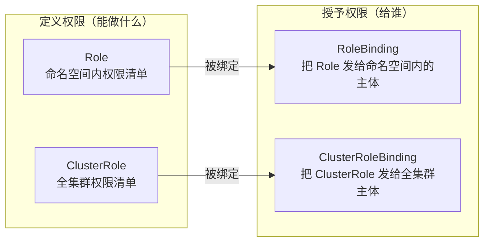
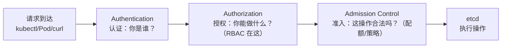
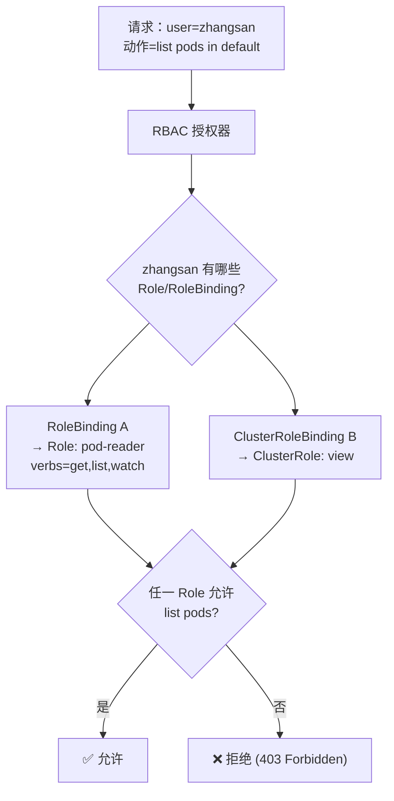

# Kubernetes RBAC 从零到精通 · 资深学习手册

> **基准版本**：Kubernetes v1.28（`rbac.authorization.k8s.io/v1`，自 1.8 起 GA）
> 版本敏感的行为差异会标注版本边界。版本不同时以 `kubectl version` 与[官方 RBAC 文档](https://kubernetes.io/docs/reference/access-authn-authz/rbac/) 为准。

---

## 阅读路径

| 你是谁 | 建议阅读顺序 |
|--------|-------------|
| **零基础**（刚接触权限控制） | 第一部分(认知) → 第三部分(最小示例) |
| **想快速给团队开权限** | 第三部分(部署配置) → 附录速查 |
| **想搞懂原理** | 第二部分(认证/授权/判定流程) |
| **运维/排障** | 第五部分(排错) + 附录命令 |
| **安全加固** | 第四部分(最佳实践) |

---

## 第零部分　5 分钟快速上手

### 0. 最快跑起来：给一个用户授予某 namespace 的只读权限

> ⚠️ 纯操作、保证成功、零解释。原理和为什么这么做，请看后面的第二部分和第三部分。

```bash
# 1. 创建一个只读 Role（在 default 这个 namespace，即"默认隔离房间"）
kubectl create role pod-reader \
  --verb=get,list,watch \
  --resource=pods \
  -n default

# 2. 把这个 Role 绑定给用户 zhangsan
kubectl create rolebinding zhangsan-read \
  --role=pod-reader \
  --user=zhangsan \
  -n default

# 3. 验证（--as=zhangsan 表示"以 zhangsan 的身份试一下"）
kubectl auth can-i list pods -n default --as=zhangsan
# 预期输出：yes
```

**5 分钟效果**：你刚刚完成了 RBAC 的核心动作——定义"能干什么"（Role），再把它"发给谁"（RoleBinding）。

---

## 第一部分　认知与定位

### 1. 它是什么、解决什么问题

**一句话定义**：RBAC（Role-Based Access Control，基于角色的访问控制）是 Kubernetes 的**授权机制**——决定"一个用户/程序，在集群里能对哪些资源做什么操作"。

> 通俗类比：RBAC 是公司的**门禁系统**。每个员工（用户）刷卡进门，卡上（Role）写了他能进哪些房间、在房间里能做什么（比如"只能看不能改"）。HR 发卡（RoleBinding）决定谁拿哪张卡。

**没有 RBAC 时的痛点**：

- 所有用户都有 root 权限，谁能改、谁不能改，完全无法控制
- 一个实习生误删生产 Deployment（工作负载的一种，如"部署的 web 服务"），无法追溯、无法阻止
- 程序（ServiceAccount，即"程序的身份卡"）拥有远超所需的权限，被攻破后整个集群沦陷

**RBAC 如何解决**：通过"角色"和"绑定"两个动作，实现**最小权限**——每个人/程序只拿到它真正需要的权限，不多不少。

### 2. 生态位置与选型对比

Kubernetes 的权限控制不是只有 RBAC 一种，但 RBAC 是**默认且最主流**的授权方式：

| 授权模式 | 定位 | 特点 | 现状 |
|---------|------|------|------|
| **RBAC** | 基于角色的授权 | 声明式、细粒度、易管理 | **默认，生产标准** |
| **Node** | 给 kubelet 的授权 | 特殊用途，自动启用 | 与 RBAC 并存 |
| **ABAC** | 基于属性的授权 | 用 JSON 文件定义规则 | 已不推荐，被 RBAC 取代 |
| **Webhook** | 外部授权服务 | 调外部 HTTP 服务做决策 | 高级场景（如对接企业 IAM） |

> **核心认知**：RBAC 是事实标准。除非你有特殊需求（如对接 OpenPolicyAgent、企业统一权限中心），否则默认用 RBAC 就对了。

### 3. 核心概念与术语

RBAC 有 4 个核心对象，两两成对：



| 术语 | 通俗类比 | 说明 |
|------|---------|------|
| **Role** | 一份"权限清单" | 只对某个 namespace 有效，如"default 里能读 Pod" |
| **ClusterRole** | 全公司的"权限清单" | 集群级，如"能读所有 namespace 的 Pod" |
| **RoleBinding** | "授权书" | 把 Role 发给某个用户/组/SA，作用于某个 namespace |
| **ClusterRoleBinding** | 全公司的"授权书" | 把 ClusterRole 发给某个主体，作用于全集群 |
| **subject**（主体） | 被授权的人/程序 | User（人）、Group（组）、ServiceAccount（程序） |
| **verb** | 动作 | get/list/watch/create/update/delete 等 |
| **namespace** | 房间/隔间 | 把资源分组隔离的逻辑边界 |

> **关键区分**：Role/ClusterRole 定义的是"**能做什么**"；RoleBinding/ClusterRoleBinding 定义的是"**给谁做**"。两者分离是 RBAC 的核心设计——权限清单可复用，授权关系灵活调整。

### 自测问题

1. Role 和 ClusterRole 的本质区别是什么？（提示：作用域）
2. RoleBinding 和 ClusterRoleBinding 分别"发"给谁？（提示：一个命名空间内，一个全集群）
3. verb 里 `get` 和 `list` 有什么区别？（提示：get 是取单个，list 是列多个）

---

## 第二部分　架构与原理

### 4. 整体架构：认证 → 授权 → 准入

RBAC 不是孤立工作的，它处在 Kubernetes API 请求处理的**第二道关卡**：



| 关卡 | 回答问题 | 用什么机制 | RBAC 在哪 |
|------|---------|-----------|----------|
| **认证 Authentication** | 你是谁？ | 证书、token、SA | ❌ 不在 |
| **授权 Authorization** | 你能做什么？ | RBAC/Node/ABAC/Webhook | ✅ **在这里** |
| **准入 Admission** | 操作合法吗？ | ValidatingWebhook/MutatingWebhook | ❌ 不在 |

> **核心认知**：RBAC 只管"**能不能做**"，不管"**你是谁**"（那是认证）和"**操作合不合规**"（那是准入）。很多人把这三者混为一谈，排障时找错方向。

### 5. 组件详解：四个对象如何协作

#### Role / ClusterRole —— 权限清单

Role 由一组 `rules` 组成，每条 rule 声明"对哪些资源，能做哪些动作"：

```yaml
apiVersion: rbac.authorization.k8s.io/v1
kind: Role
metadata:
  namespace: default          # Role 必须指定 namespace
  name: pod-reader
rules:
- apiGroups: [""]             # 核心 API 组（空字符串）
  resources: ["pods"]         # 资源：pods
  verbs: ["get", "list", "watch"]  # 动作
```

关键字段：

| 字段 | 含义 | 例子 |
|------|------|------|
| `apiGroups` | API 组，核心组用 `""` | `[""]`、`["apps"]`、`["rbac.authorization.k8s.io"]` |
| `resources` | 资源类型 | `pods`、`deployments`、`secrets` |
| `verbs` | 允许的动作 | `get/list/watch/create/update/patch/delete` |
| `resourceNames` | 限定到具体资源名（可选） | `["my-config"]` 只允许操作这一个 |

#### RoleBinding / ClusterRoleBinding —— 授权书

RoleBinding 把 Role（或 ClusterRole）绑定到 subject（主体）：

```yaml
apiVersion: rbac.authorization.k8s.io/v1
kind: RoleBinding
metadata:
  name: read-pods
  namespace: default
subjects:                     # 发给谁
- kind: User                  # 或 Group / ServiceAccount
  name: zhangsan
  apiGroup: rbac.authorization.k8s.io
roleRef:                      # 发什么权限
  kind: Role                  # 或 ClusterRole
  name: pod-reader
  apiGroup: rbac.authorization.k8s.io
```

subject 三种类型：

| kind | 是什么 | name 格式 |
|------|--------|----------|
| `User` | 普通用户（人） | 如 `zhangsan`（来自证书 CN，即 Common Name，见第 7 节） |
| `Group` | 用户组 | 如 `system:masters`、`dev-team` |
| `ServiceAccount` | 程序身份 | YAML 中用 `name` + `namespace` 两个字段；命令行用 `namespace:name` |

### 6. 工作原理：授权判定流程

当请求经过认证后，RBAC 授权器开始判定"这个用户能不能做这件事"：



**三条核心判定规则**：

1. **权限是叠加的（additive）**：多个 Role 的权限取并集，越绑越多权限。
2. **没有 deny 语义**：RBAC 不能写"禁止某操作"的规则，只能"允许"。RBAC 本身就是"默认拒绝"——没有匹配的允许规则即 deny。若要在 RBAC 之外实现显式的排除式规则（如"除了 X 以外都禁止"），需靠 **Webhook 授权器**或 **ValidatingAdmissionWebhook（准入控制器）**。
3. **任一允许即通过**：只要有一个 Role 允许这个操作，就放行。

> ⚠️ **常见误区**：有人以为"不给权限 = 拒绝"，其实 RBAC 里"没有授权"和"明确拒绝"是同一件事（都是 deny）。区别只在于 RBAC 无法表达"除了 X 以外都允许"这种排除式规则。

### 7. 底层机制：认证如何映射出用户身份

RBAC 判定时，`user` 和 `group` 从哪来？这取决于认证方式：

#### X509 客户端证书（最常见于 kubectl 管理员）

证书的 **CN（Common Name）字段 → username**，**O（Organization）字段 → group**：

```bash
# 生成客户端证书（CN=zhangsan, O=dev-team）
openssl req -new -key zhangsan.key -out zhangsan.csr \
  -subj "/CN=zhangsan/O=dev-team"

# 用集群 CA 签发
openssl x509 -req -in zhangsan.csr \
  -CA /etc/kubernetes/pki/ca.crt \
  -CAkey /etc/kubernetes/pki/ca.key \
  -CAcreateserial -out zhangsan.crt -days 3650
```

结果：这个证书认证后，RBAC 看到的身份是 `user=zhangsan, group=dev-team`。

#### ServiceAccount（程序身份）

Pod 内的程序通过 ServiceAccount 的 JWT token 认证，用户名是：

```text
system:serviceaccount:<namespace>:<serviceaccount-name>
```

如 `system:serviceaccount:default:my-app`。

#### system:masters 特殊组

`O=system:masters` 的证书，认证后属于 `system:masters` 组。该组**被默认的 ClusterRoleBinding 预先绑定到 `cluster-admin` 超级角色**（kube-apiserver 引导时自动创建），因此拥有全集群所有资源的完全控制权。

> 🔴 **高危**：`system:masters` 是"万能钥匙"，CIS 安全基线明确建议**避免使用**。生产环境应给每个用户最小权限，而不是都发 system:masters。

### 自测问题

1. RBAC 的"拒绝"和"没授权"有区别吗？（提示：没有，都是 deny）
2. 一个用户绑定了两个 Role，一个允许 list pods，一个不允许，结果如何？（提示：叠加，允许）
3. 证书的 CN 和 O 分别映射成什么？（提示：username 和 group）

---

## 第三部分　部署与配置

### 8. 最小可运行示例：namespace 级只读用户

**场景**：给用户 `alice` 授予在 `dev` namespace 里读 Pod 的权限。

```bash
# 1. 创建 Role（只读 pods）
kubectl create role pod-reader \
  --verb=get,list,watch \
  --resource=pods \
  -n dev

# 2. 绑定给 alice
kubectl create rolebinding alice-read-pods \
  --role=pod-reader \
  --user=alice \
  -n dev

# 3. 验证
kubectl auth can-i list pods -n dev --as=alice   # yes
kubectl auth can-i delete pods -n dev --as=alice  # no
```

### 9. 内置 ClusterRole：admin / edit / view

Kubernetes 自带三个面向用户的默认 ClusterRole：

| ClusterRole | 权限范围 | 能做什么 | 典型用途 |
|------------|---------|---------|---------|
| **view** | 只读 | get/list/watch 大部分资源，**但不含 Secret、Role/RoleBinding** | 审计、只读查看 |
| **edit** | 大部分读写 | 增删改大部分资源（**含 Secret**），但不改 RBAC | 开发者在自己的 namespace |
| **admin** | edit + RBAC | 还能管理本 namespace 的 Role/RoleBinding | namespace 管理员 |
| **cluster-admin** | 全部 | 集群所有权限（含所有 namespace） | 集群管理员 |

> ⚠️ **关键差异**：`view` 明确**排除 Secret 的读取权限**（读 Secret 等于拿到 SA 凭证，可提权），而 `edit` **包含 Secret 读写**。这是 `view` 和 `edit` 之间最容易被忽略、也最影响安全的一点。另外 `edit`/`admin` 从 v1.22 起不含 EndpointSlices 写权限。

> **核心技巧**：`edit`/`view` 是 **ClusterRole**，但可以用 **RoleBinding** 把它们绑定到某个 namespace——这样用户只在那个 namespace 有 edit/view 权限，而不是全集群。这是"用集群级角色做命名空间级授权"的常用模式。

```bash
# 给 alice 在 dev namespace 授予 edit 权限（用内置 ClusterRole）
kubectl create rolebinding alice-edit \
  --clusterrole=edit \
  --user=alice \
  -n dev
```

### 10. 客户端证书签发（给集群外的人发 kubeconfig）

**场景**：给一个集群外的运维人员签发证书，让他能通过 kubectl 操作集群。

完整流程见本文档开头"第零部分"的思想，这里是完整命令：

```bash
# 1. 生成私钥 + CSR（Certificate Signing Request，证书签名请求——向 CA 申请签名的申请书）
#    CN=用户名（Common Name），O=组（Organization）
openssl genrsa -out alice.key 2048
openssl req -new -key alice.key -out alice.csr -subj "/CN=alice/O=dev-team"

# 2. 用集群 CA 签发（在 master 节点执行）
openssl x509 -req -in alice.csr \
  -CA /etc/kubernetes/pki/ca.crt \
  -CAkey /etc/kubernetes/pki/ca.key \
  -CAcreateserial -out alice.crt -days 3650

# 3. 生成 kubeconfig
kubectl config set-cluster myk8s --server=https://<master-ip>:6443 \
  --certificate-authority=/etc/kubernetes/pki/ca.crt --embed-certs=true \
  --kubeconfig=alice.kubeconfig
kubectl config set-credentials alice \
  --client-certificate=alice.crt --client-key=alice.key --embed-certs=true \
  --kubeconfig=alice.kubeconfig
kubectl config set-context alice@myk8s --cluster=myk8s --user=alice \
  --kubeconfig=alice.kubeconfig
kubectl config use-context alice@myk8s --kubeconfig=alice.kubeconfig

# 4. 发一个 kubeconfig 配置文件给他——相当于他的"门禁卡 + 大楼地图"
scp alice.kubeconfig root@外部节点:/root/.kube/config
```

> ⚠️ `ca.key` 是集群根私钥（600 权限），签发客户端证书必须用它。它一旦泄露，等于整个集群沦陷。

### 自测问题

1. `view` 是 ClusterRole，如何让用户只在某个 namespace 有 view 权限？（提示：用 RoleBinding 绑定 ClusterRole）
2. `edit` 和 `admin` 的区别是什么？（提示：admin 多 RBAC 管理权限）
3. 给集群外用户发 kubeconfig，`--embed-certs=true` 的作用是什么？（提示：把证书内嵌进文件）

---

## 第四部分　生产最佳实践

### 11. 最小权限原则（Least Privilege）

**核心原则**：只给完成工作所需的最少权限，不多不少。

| 反模式 | 正确做法 |
|--------|---------|
| 给所有人 cluster-admin | 按角色分 namespace，给 edit/view |
| 用 system:masters 组 | 用普通用户 + 明确 Role |
| 程序用 default SA（SA = ServiceAccount） | 每个程序独立 SA + 最小 Role |
| 用通配符 `verbs: ["*"]` | 明确列出需要的 verb |

### 12. 权限升级预防

Kubernetes 有一道安全机制：**你不能授予超过自己拥有的权限**。

精确机制依赖 RBAC 的两个特殊 verb：

- **`escalate`**：创建/更新 Role 时，用户必须已拥有该 Role 内的全部权限，**或**对该 Role 持有 `escalate` verb
- **`bind`**：创建 RoleBinding 绑定某个角色时，必须已拥有该角色全部权限，**或**持有 `bind` verb

例如：一个只有 `edit` 权限的用户，无法创建 `admin` 的 RoleBinding（因为 `edit` 不含 RBAC 管理权限，也没有 `bind`）。这防止了权限从低向高"自我提升"。

### 13. ServiceAccount 安全

- 每个应用使用**独立的 ServiceAccount**，不要共用 default
- ServiceAccount 的 token 是程序身份的凭证，避免泄露
- ⚠️ K8s 1.24 起，`LegacyServiceAccountTokenNoAutoGeneration` 特性门默认启用——**创建 ServiceAccount 时不再自动生成旧的 Secret 类型 token**（`kubernetes.io/service-account-token`）。但 **Pod 仍默认自动挂载 projected 类型的短期 JWT token**（`automountServiceAccountToken` 字段默认仍为 `true`）。如需禁用，须在 PodSpec 或 ServiceAccount 上显式设置 `automountServiceAccountToken: false`。

---

## 第五部分　故障排查与速查

### 14. 排障速查表

| 现象 | 可能原因 | 排查命令 | 解决 |
|------|---------|---------|------|
| `Error from server (Forbidden)` | 没有对应权限 | `kubectl auth can-i <verb> <resource> --as=<user>` | 补 Role/RoleBinding |
| 用户能读但不能写 | Role 缺写 verb | 检查 Role 的 verbs | 加 create/update/delete |
| 跨 namespace 访问被拒 | 用 Role 而非 ClusterRole | 检查 Role 作用域 | 改用 ClusterRole + RoleBinding |
| SA 访问被拒 | SA 没绑定 Role | `kubectl auth can-i ... --as=system:serviceaccount:ns:sa` | 给 SA 加 RoleBinding |
| 明明绑了还是 403 | 绑定作用域/namespace 不对 | `kubectl get rolebinding -A` 核对 | 修正 namespace |

### 15. 常用命令速查

```bash
# 检查权限
kubectl auth can-i list pods -n default
kubectl auth can-i list pods -n default --as=zhangsan
kubectl auth can-i --list -n default --as=zhangsan   # 列出所有权限（--list = 列出全部）

# 查看角色和绑定（-n 指定 namespace，-A 表示 all-namespaces，即所有 namespace）
kubectl get role,rolebinding -n default
kubectl get clusterrole,clusterrolebinding

# 查看谁有 cluster-admin
kubectl get clusterrolebinding | grep cluster-admin

# 查看某个 role 的详细规则
kubectl describe clusterrole edit

# 创建（命令式）
kubectl create role <name> --verb=get,list --resource=pods -n <ns>
kubectl create rolebinding <name> --role=<role> --user=<user> -n <ns>
kubectl create clusterrolebinding <name> --clusterrole=view --user=<user>
```

### 自测问题

1. `kubectl auth can-i` 不带 `--as` 时，检查的是谁的身份？（提示：当前 kubeconfig 的用户）
2. 如何快速确认某个用户是不是 cluster-admin？（提示：查 clusterrolebinding）
3. 排障时，403 错误优先查什么？（提示：auth can-i + 核对 RoleBinding 的 namespace）

---

## 附录

### A. 术语表

| 术语 | 通俗类比 |
|------|---------|
| RBAC | 门禁系统：刷卡进门，卡上写了能进哪些房间 |
| Role | 权限清单（命名空间内） |
| ClusterRole | 全集群权限清单 |
| RoleBinding | 授权书（命名空间内） |
| ClusterRoleBinding | 全集群授权书 |
| subject | 被授权的主体（人/组/程序） |
| ServiceAccount | 给程序用的身份卡 |
| verb | 动作：get/list/create/delete 等 |
| system:masters | 万能钥匙组（高危） |
| namespace | 房间/隔间 |

### B. 参考资料

| 主题 | URL |
|------|-----|
| RBAC 官方文档 | https://kubernetes.io/docs/reference/access-authn-authz/rbac/ |
| 授权机制 | https://kubernetes.io/docs/reference/access-authn-authz/authorization/ |
| 认证机制 | https://kubernetes.io/docs/reference/access-authn-authz/authentication/ |
| RBAC 最佳实践 | https://kubernetes.io/docs/concepts/security/rbac-good-practices/ |
| Role API 参考 | https://kubernetes.io/docs/reference/kubernetes-api/authorization-resources/role-v1/ |
| ClusterRole API 参考 | https://kubernetes.io/docs/reference/kubernetes-api/authorization-resources/cluster-role-v1/ |

---

> 本文档基于 Kubernetes v1.28，事实来源于 [Kubernetes 官方文档](https://kubernetes.io/docs/reference/access-authn-authz/)，每条关键主张经多个独立来源交叉核实。如发现错误请提 Issue。
