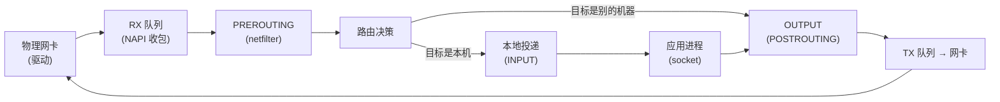
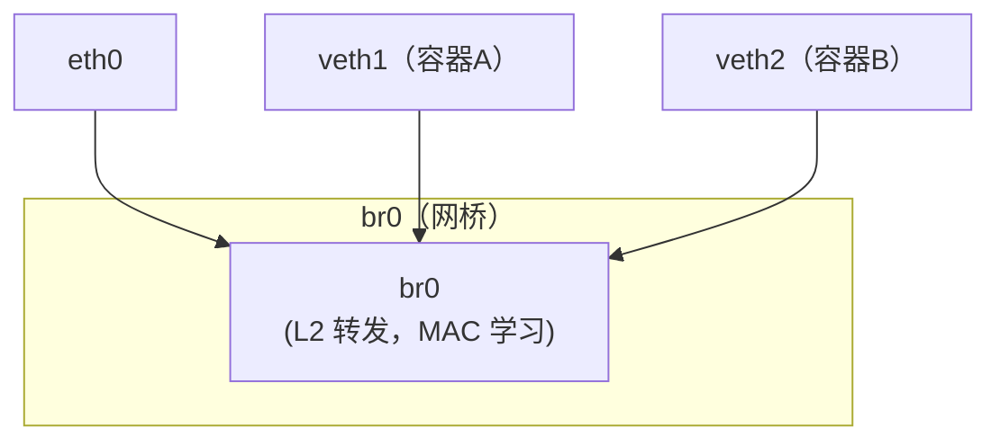
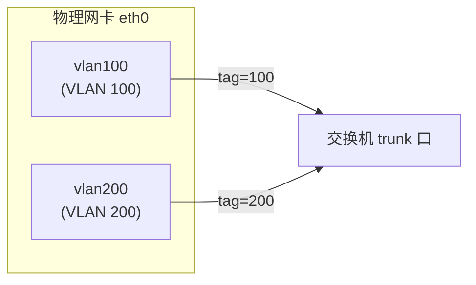
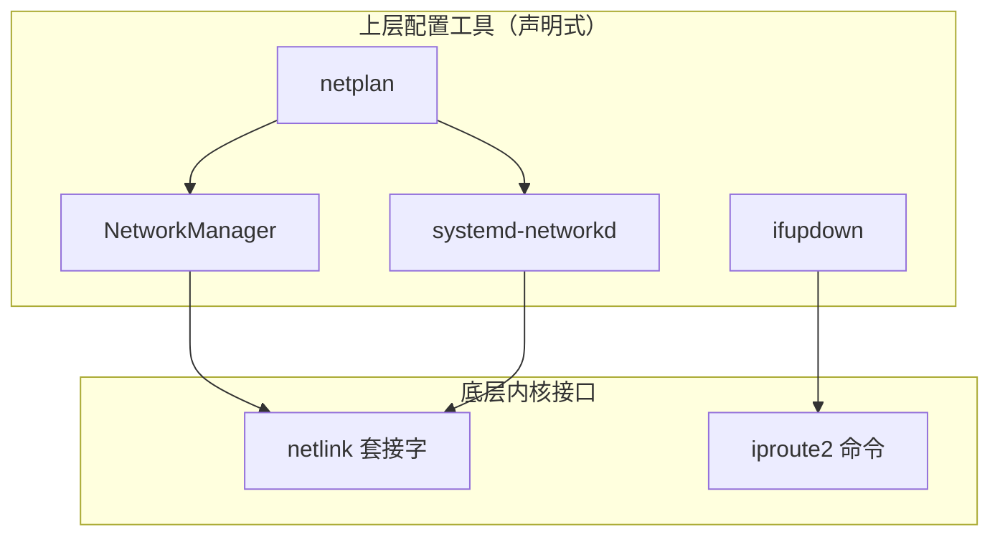

# Linux 网络接口与配置 从零到精通 · 资深学习手册

> **基准版本**：iproute2（`ip` 命令）/ NetworkManager 1.x / systemd-networkd 249+ / netplan 0.10x / Linux 内核 5.x-6.x
> 覆盖发行版：**RHEL 7/8/9、CentOS 7/Stream、Debian、Ubuntu 20.04/22.04/24.04**
> 版本敏感的行为差异会标注版本边界（如 RHEL 9 起 ifcfg → keyfile、Ubuntu 17.10 起 ifupdown → netplan）。版本不同时以各发行版官方文档为准。

---

## 阅读路径

| 你是谁 | 建议阅读顺序 |
|--------|-------------|
| **零基础**（刚接触 Linux 网络） | 第零部分 → 第一部分 → 第 6 节（ip a 解析） |
| **要配网卡/网桥/bond** | 第三部分（按你的发行版选配置方式） |
| **想搞懂原理** | 第二部分（内核网络栈 + 网卡命名 + 网桥/bond 原理） |
| **运维排障** | 第四部分 + 第五部分速查表 |
| **查具体命令/字段** | 附录速查卡 |

---

## 第零部分　5 分钟快速上手

### 0. 最快跑起来：查看网卡并临时配个 IP

> ⚠️ 纯操作、零解释。原理和"为什么"请看第二部分。

```bash
# 1. 看所有网卡（最重要的第一条命令）
ip a

# 2. 只看简要网卡列表
ip -br a

# 3. 临时给 eth0 加一个 IP（/24 表示子网范围，先照抄，含义见第 3 节；重启后失效）
ip addr add 192.168.1.100/24 dev eth0

# 4. 启用网卡
ip link set eth0 up

# 5. 看路由
ip route show
# 或
ip r
```

**5 分钟效果**：你已经会了 Linux 网络运维 80% 的日常动作——看网卡、配 IP、启停网卡、看路由。

---

## 第一部分　认知与定位

### 1. 它是什么：Linux 网络接口

Linux 里"网卡"的专业术语是**网络接口（network interface）**。它不只是物理网卡，还包括各种**虚拟接口**：

> 通俗类比：接口就像"门"——物理网卡是"通向外面的实体门"，虚拟接口（网桥、veth、bond、vlan）是"内部隔间之间开的门"。`ip a` 看到的所有条目，都是这些"门"。

Linux 网络接口分两大类：

| 类型 | 举例 | 说明 |
|------|------|------|
| **物理接口** | `eth0`、`eno1`、`ens33` | 真实网卡 |
| **虚拟接口** | `lo`、`br0`（网桥）、`bond0`（绑定）、`veth`（虚拟网线）、`vlan100`（VLAN）、`tun0/tap0`（隧道，把一份包裹装进另一个包裹里寄出，用于 VPN/加密通道） | 内核创建的软设备 |

### 2. 生态位置：ifconfig 已死，ip 当立

老运维熟悉的 `ifconfig` 命令，来自 **net-tools** 软件包，已被淘汰。现代 Linux 统一用 **iproute2** 提供的 `ip` 命令。

| 旧命令（net-tools，已废弃） | 新命令（iproute2） | 作用 |
|---------------------------|-------------------|------|
| `ifconfig` | `ip a` / `ip addr` | 看/配 IP |
| `route` / `netstat -r` | `ip route` / `ip r` | 看/配路由 |
| `arp` | `ip neigh` | ARP 表（ARP = 地址解析协议，负责把 IP 门牌号翻译成 MAC 物理编号） |
| `brctl`（bridge-utils） | `ip link add ... type bridge` | 网桥 |
| `netstat` | `ss` | 连接/端口 |

> **参考**：[iproute2](https://wiki.linuxfoundation.org/networking/iproute2) | [net-tools 弃用说明](https://www.centos.org/forums/viewtopic.php?t=74458)

### 3. 核心概念与术语

| 术语 | 通俗类比 | 说明 |
|------|---------|------|
| 网络接口 | 一扇"门" | 物理或虚拟网卡 |
| IP 地址 | 门牌号 | 网络层寻址 |
| 子网掩码/前缀 | 门牌号的范围规则 | 如 /24 = 前 24 位是网络位 |
| MAC 地址 | 门的物理编号 | L2 层寻址 |
| MTU | 单个包裹的最大尺寸 | 默认 1500 字节 |
| 网桥 bridge | 内部"交换机" | L2 转发，如 docker 的 cni0 |
| veth pair | 一根虚拟网线 | 一头在容器/命名空间，一头在宿主 |
| bond/team | 多网卡"捆成一股" | 冗余 + 聚合带宽 |
| VLAN | 虚拟局域网 | 逻辑分割网络 |
| qdisc | 网卡的"排队规则" | 流量调度 |
| NetworkManager | 网络配置管家 | RHEL/CentOS/Ubuntu 桌面 |
| netplan | Ubuntu 的网络配置层 | YAML 声明式 |
| systemd-networkd | systemd 的网络组件 | 服务端常用 |

### 自测问题

1. `ip a` 和 `ifconfig` 有什么区别？为什么现在要用 `ip`？
2. 物理接口和虚拟接口的区别？各举一个例子。
3. `/24` 这个前缀是什么意思？

---

## 第二部分　架构与原理

### 4. 内核网络栈：数据包的一生

> 读完本节你能做到：说清一个包从网卡到应用，经过了内核哪些处理环节。

Linux 网络栈是内核的一部分，数据包处理链路大致如下：



关键机制：

- **NAPI**：新式收包机制，用中断+轮询混合，高吞吐下减少中断风暴
- **netfilter**：内核的包过滤框架，`iptables`/`nftables` 都建立在其上（K8s 的 Service 转发就是靠它）
- **socket buffer (sk_buff)**：数据包在内核里的"数据结构载体"

> **参考**：[Linux Networking 文档](https://www.kernel.org/doc/html/latest/networking/) | [netfilter](https://www.netfilter.org/)

### 5. 网卡命名规则：为什么不再叫 eth0

现代 Linux（systemd 时代）用**可预测命名（Predictable Network Interface Names）**替代老的 eth0/eth1：

| 前缀 | 命名依据 | 例子 |
|------|---------|------|
| `eno` | 板载（onboard）设备，按 BIOS/固件提供的索引 | `eno1` |
| `ens` | 按 PCI 槽位（slot） | `ens33` |
| `enp` | 按 PCI 总线/槽位/功能号 | `enp0s3` |
| `enx` | 按 MAC 地址 | `enx00e04c...` |
| `eth` | 传统内核命名（已不推荐） | `eth0` |

> **核心**：可预测命名解决的是"多网卡时，重启后 eth0/eth1 顺序会变"的老问题。新的命名和物理位置绑定，不会漂移。

> **参考**：[systemd 命名方案](https://www.freedesktop.org/software/systemd/man/systemd.net-naming-scheme.html) | [RHEL 一致性命名](https://docs.redhat.com/en/documentation/red_hat_enterprise_linux/7/html/networking_guide/ch-consistent_network_device_naming)

### 6. `ip a` 输出逐字段解析（本手册核心）

> 读完本节你能做到：`ip a` 输出的每一个字符、每一个字段，你都能解释出含义。

这是整篇文档的重中之重——`ip a` 是 Linux 网络排障的第一命令。以下是一段典型输出：

```text
1: lo: <LOOPBACK,UP,LOWER_UP> mtu 65536 qdisc noqueue state UNKNOWN group default qlen 1000
    link/loopback 00:00:00:00:00:00 brd 00:00:00:00:00:00
    inet 127.0.0.1/8 scope host lo
       valid_lft forever preferred_lft forever
    inet6 ::1/128 scope host
       valid_lft forever preferred_lft forever

2: eth0: <BROADCAST,MULTICAST,UP,LOWER_UP> mtu 1500 qdisc fq_codel state UP group default qlen 1000
    link/ether 00:0c:29:3a:36:49 brd ff:ff:ff:ff:ff:ff
    inet 192.168.104.104/24 brd 192.168.104.255 scope global eth0
       valid_lft forever preferred_lft forever
    inet6 fe80::20c:29ff:fe3a:3649/64 scope link
       valid_lft forever preferred_lft forever
```

#### 第一行：接口概览

```text
2: eth0: <BROADCAST,MULTICAST,UP,LOWER_UP> mtu 1500 qdisc fq_codel state UP group default qlen 1000
```

逐字段拆解：

| 字段 | 含义 | 说明 |
|------|------|------|
| `2:` | 接口索引号（ifindex） | 内核内部编号，唯一 |
| `eth0` | 接口名 | 见第 5 节命名规则 |
| `<...>` | **接口标志（flags）** | 尖括号里是功能标志 |
| `mtu 1500` | 最大传输单元 | 单包最大字节数 |
| `qdisc fq_codel` | 排队规则 | `fq_codel`=公平队列调度算法（防单流霸占带宽），`noqueue`=虚拟接口无排队 |
| `state UP` | 运行状态（operstate，RFC 2863） | 反映链路真实状态：UP=admin up 且载波存在；DOWN=admin down 或载波丢失；UNKNOWN=驱动不报告载波（如 lo、隧道） |
| `group default` | 接口组 | 默认组 |
| `qlen 1000` | 传输队列长度 | 发送队列 |

**尖括号里的标志位（最关键）**：

| 标志 | 含义 |
|------|------|
| `LOOPBACK` | 回环接口（lo） |
| `BROADCAST` | 支持广播 |
| `MULTICAST` | 支持组播 |
| `UP` | 接口已启用（`ip link set up`） |
| `LOWER_UP` | 物理链路层已连接（网线插着、交换机通） |
| `NO-CARRIER` | 物理层无载波（网线没插） |
| `NOARP` | 不响应 ARP |
| `PROMISC` | 混杂模式 |

> **关键区分**：`UP` ≠ `LOWER_UP`。
> - `UP` = 软件层面启用了（管理员执行了 `ip link set up`）
> - `LOWER_UP` = 物理层真的通了（网线插好、对端链路正常）
> - 排障口诀：**有 UP 没 LOWER_UP = 网线问题/交换机端口问题；两个都没有 = 接口没启用**

#### 第二行：链路层地址

```text
link/ether 00:0c:29:3a:36:49 brd ff:ff:ff:ff:ff:ff
```

| 字段 | 含义 |
|------|------|
| `link/ether` | 链路类型是以太网 |
| `00:0c:29:3a:36:49` | MAC 地址 |
| `brd ff:ff:ff:ff:ff:ff` | 广播 MAC 地址 |

其他链路类型：`link/loopback`（回环）、`link/ipip`（IPIP 隧道，如 tunl0）、`link/gre`（GRE 隧道）、`link/none`（无链路层，用于某些特殊虚拟设备）。

#### 第三行：IPv4 地址

```text
inet 192.168.104.104/24 brd 192.168.104.255 scope global eth0
```

| 字段 | 含义 |
|------|------|
| `inet` | IPv4 地址 |
| `192.168.104.104/24` | 地址 + 前缀长度（/24 = 子网掩码 255.255.255.0） |
| `brd 192.168.104.255` | 广播地址 |
| `scope global` | 作用域（global=全局可路由，host=仅本机，link=仅链路层） |
| `eth0` | 该地址所属接口 |

#### 第四、五行：地址有效期

```text
valid_lft forever preferred_lft forever
```

| 字段 | 含义 |
|------|------|
| `valid_lft` | 有效生存期（forever = 永久，否则是秒数） |
| `preferred_lft` | 首选生存期（DHCP 地址会显示剩余时间） |

> DHCP 分配的地址，这里会显示倒计时秒数，而不是 `forever`。

#### IPv6 地址

```text
inet6 fe80::20c:29ff:fe3a:3649/64 scope link
```

`fe80::` 开头的是**链路本地地址（link-local）**，每个启用 IPv6 的接口自动生成，`scope link` 表示只在本地链路有效，不能路由。

> **参考**：[ip-address 手册](https://man7.org/linux/man-pages/man8/ip-address.8.html) | [ip-link 手册](https://man7.org/linux/man-pages/man8/ip-link.8.html)

### 7. 网桥 bridge 原理

网桥是**虚拟二层交换机**——把多个接口"桥接"在一起，在它们之间做 L2 转发（按 MAC 地址）。



网桥在容器/K8s 网络里无处不在（docker 的 `docker0`、K8s Flannel 的 `cni0`）。

#### 7.1 手动创建网桥（完整步骤）

网桥**不会自动有 IP**，也不会自动把网卡加进来——都需要手动做。以下是通用 `ip` 命令流程：

```bash
# 1. 创建一个网桥（刚创建时是空的，没有任何成员）
ip link add br0 type bridge

# 2. 把物理网卡/虚拟接口加进网桥
ip link set eth0 master br0

# 3. 启用网桥
ip link set br0 up

# 4. （可选）给网桥配 IP——网桥本身可以作为一个 L3 接口有 IP
ip addr add 192.168.104.104/24 dev br0
```

> **关键概念：网桥要不要配 IP？**
> - **要配 IP**：当网桥需要作为"网关"或"宿主对外入口"时（如 K8s 的 cni0 有 IP，作为本节点 Pod 的网关）
> - **不配 IP**：当网桥只做纯 L2 转发（如 libvirt/QEMU 的 virbr0 可以不配，纯做虚拟机二层互通）
> - 配了 IP 的网桥，等价于"一个二层交换机 + 一个挂在交换机上的 L3 端口"。

**关键内核参数**（K8s 必配）：

```bash
net.bridge.bridge-nf-call-iptables = 1
```

含义：**让经过网桥的包也经过 iptables 过滤**。默认网桥流量不经过 iptables，但 K8s 需要它来给容器流量做 DNAT/策略，所以必须开启。

> **参考**：[Linux bridge 文档](https://www.kernel.org/doc/html/latest/networking/bridge.html) | [bridge-nf 说明](https://www.netfilter.org/documentation/HOWTO/netfilter-bridging-HOWTO.html)

### 8. bond / team 绑定原理

bond（绑定）把多块物理网卡"捆绑"成一块逻辑网卡，提供**冗余**和/或**带宽聚合**。

| bond 模式 | 名称 | 是否需要交换机支持 | 作用 |
|-----------|------|:---:|------|
| mode=0 | balance-rr | 需要 | 轮询，带宽叠加 |
| mode=1 | active-backup | 不需要 | 主备冗余（最常用） |
| mode=2 | balance-xor | 需要 | 按 MAC 哈希 |
| mode=4 | 802.3ad (LACP) | 需要 | 标准链路聚合（生产首选） |
| mode=5 | balance-tlb | 不需要 | 发送负载均衡 |
| mode=6 | balance-alb | 不需要 | 收发负载均衡 |

> **核心**：`active-backup`（mode=1）是"一根线断了自动切到另一根"，不需要交换机配置，最适合"只要冗余不要聚合"的场景。`802.3ad`（mode=4）是标准 LACP，需要交换机配合，适合"既要冗余又要带宽"。

#### 8.1 bond 不会自动有 IP（关键）

**bond 创建后只是一个"空的逻辑网卡"，不会自动获得 IP**——必须像普通网卡一样手动配 IP：

```bash
# 创建 bond 后，给 bond0 配 IP
ip addr add 192.168.104.104/24 dev bond0
# 或配 DHCP
dhclient bond0
```

> **核心认知**：bond 解决的是"物理链路冗余/聚合"，IP 是另一回事——bond0 配了 IP 后，逻辑上和"一块有 IP 的普通网卡"没区别。很多新手误以为"建了 bond 就自动有网了"，其实建 bond 只是第一步，配 IP、配路由、配 DNS 一步都不能少。

#### 8.2 网桥 vs bond 什么时候用（核心选型）

这是最常被问的问题：

| 对比维度 | 网桥 bridge | bond |
|---------|-----------|------|
| **本质** | 虚拟**二层交换机**（多口转发） | 多网卡**捆成一股**（冗余/聚合） |
| **解决的问题** | 让多个接口在 L2 层互通 | 让多根物理链路变成一个高可用/高带宽逻辑链路 |
| **典型场景** | 虚拟机/容器网络、KVM、docker、K8s CNI | 服务器双网卡冗余、存储/计算节点高吞吐 |
| **成员** | 物理网卡 + veth + tap 等混合 | 通常是多块物理网卡 |
| **有 IP 吗** | 可有可无（当网关时配，纯转发时可不配） | 通常配（作为对外接口） |
| **和"冗余"的关系** | 本身不做冗余 | 冗余是其核心目的之一 |

> **一句话选型**：
> - 想让"多台虚拟机/容器互相通信、且和宿主机通信" → 用**网桥**
> - 想让"这台服务器的两根网线互为备份/叠加带宽" → 用 **bond**
> - 两者常组合使用：bond0 提供链路冗余，再把 bond0 加进 br0 给虚拟机用。

> **参考**：[Linux bonding 文档](https://www.kernel.org/doc/html/latest/networking/bonding.html)

### 9. VLAN 原理

VLAN（虚拟局域网）在**一根物理链路**上跑**多个逻辑隔离的网络**，通过 802.1Q 标签区分。



在 Linux 里，VLAN 接口叫 `eth0.100`（老命名）或 `vlan100`（可自定义），每个 VLAN 接口有独立 IP、独立路由。

> **参考**：[VLAN 802.1Q](https://www.kernel.org/doc/html/latest/networking/vlan.html)

### 自测问题

1. `ip a` 里 `UP` 和 `LOWER_UP` 分别代表什么？网线拔了会显示哪个？
2. `state UNKNOWN` 常见于哪些接口？（提示：回环、网桥、隧道等虚拟接口）
3. `scope host` 和 `scope global` 有什么区别？
4. bond mode=1 和 mode=4 的核心区别是什么？
5. `net.bridge.bridge-nf-call-iptables` 为什么 K8s 必须开？

---

## 第三部分　各发行版的网络配置

> 读完本部分你能做到：在 RHEL/CentOS/Debian/Ubuntu 上，用各自的"官方姿势"持久化配置网卡 IP、网桥、bond、VLAN。

### 10. 发行版网络配置体系总览

Linux 各发行版的网络配置工具经历了历史演变，形成两大家族：

| 发行版 | 主配置工具 | 配置文件位置 | 底层渲染器 |
|--------|-----------|-------------|-----------|
| **RHEL 7 / CentOS 7** | NetworkManager（或传统 network scripts） | `/etc/sysconfig/network-scripts/ifcfg-*` | ifcfg-rh |
| **RHEL 8 / CentOS Stream 8** | NetworkManager（ifcfg 默认，keyfile 可选） | `/etc/sysconfig/network-scripts/ifcfg-*` | ifcfg-rh |
| **RHEL 9 / CentOS Stream 9** | NetworkManager（keyfile 格式） | `/etc/NetworkManager/system-connections/*.nmconnection` | keyfile |
| **Debian** | ifupdown/ifupdown2、systemd-networkd 或 NetworkManager（取决于安装环境） | `/etc/network/interfaces`、`/etc/systemd/network/` 或 NetworkManager profiles | ifupdown、networkd 或 keyfile |
| **Ubuntu 17.10+** | netplan | `/etc/netplan/*.yaml` | networkd 或 NetworkManager |
| **Ubuntu Server / 容器** | systemd-networkd | `/etc/systemd/network/*.network` | networkd |

> **核心认知**：这些工具最终都调内核的 `ip`/`netlink` 接口去配置网卡。区别只是"配置文件格式"和"谁在管理"。理解这一点，就不会被"为什么 Ubuntu 和 CentOS 配置方法完全不同"搞懵。



### 11. RHEL 7 / CentOS 7：ifcfg 文件

> 适用：RHEL 7、CentOS 7（本套 K8s 集群使用的就是这套）

#### 11.1 静态 IP 配置

```bash
# 配置文件：/etc/sysconfig/network-scripts/ifcfg-eth0
cat > /etc/sysconfig/network-scripts/ifcfg-eth0 << 'EOF'
TYPE=Ethernet
BOOTPROTO=static          # static=静态，dhcp=动态
DEFROUTE=yes              # 设为默认路由
NAME=eth0
DEVICE=eth0
ONBOOT=yes                # 开机自动启用
IPADDR=192.168.104.104
NETMASK=255.255.255.0
GATEWAY=192.168.104.2
DNS1=223.5.5.5
DNS2=114.114.114.114

EOF

# 重启网络服务生效
systemctl restart network
```

#### 11.2 查看/验证

```bash
# 查看所有网卡配置
ls /etc/sysconfig/network-scripts/ifcfg-*

# 查看当前生效的 IP
ip a show eth0

# 查看网关/路由
ip route show
```

> **参考**：[RHEL 7 网络指南](https://docs.redhat.com/en/documentation/red_hat_enterprise_linux/7/html/networking_guide/)

### 11.3 RHEL 7 / CentOS 7：ifcfg 持久化 bond

`bond0` 的地址必须写在 bond 配置中；物理从接口只写 `MASTER`/`SLAVE`，不要给从接口配置地址或默认网关。

```bash
# /etc/sysconfig/network-scripts/ifcfg-bond0
DEVICE=bond0
NAME=bond0
TYPE=Bond
BONDING_MASTER=yes
BOOTPROTO=static
ONBOOT=yes
IPADDR=192.168.104.104
PREFIX=24
GATEWAY=192.168.104.2
DNS1=223.5.5.5
BONDING_OPTS="mode=active-backup miimon=100 primary=eth0"

# /etc/sysconfig/network-scripts/ifcfg-eth0
DEVICE=eth0
TYPE=Ethernet
ONBOOT=yes
BOOTPROTO=none
MASTER=bond0
SLAVE=yes

# /etc/sysconfig/network-scripts/ifcfg-eth1
DEVICE=eth1
TYPE=Ethernet
ONBOOT=yes
BOOTPROTO=none
MASTER=bond0
SLAVE=yes
```

```bash
systemctl restart network
cat /proc/net/bonding/bond0
ip -br addr show bond0 eth0 eth1
```

> `mode=4`（LACP/802.3ad）不是只改一个字符串：交换机端口通常必须配置同一个 LAG、成员口速率/双工和 VLAN；未完成交换机侧配置时优先使用 `active-backup` 做验证。


> 适用：RHEL 8/9、CentOS Stream 8/9。RHEL 9 起**彻底告别 ifcfg 文件**，改用 keyfile 格式。

#### 12.1 nmcli 命令式配置（推荐）

```bash
# 查看所有连接
nmcli connection show

# 创建静态 IP 连接
nmcli connection add type ethernet con-name eth0 ifname eth0   ipv4.addresses 192.168.104.104/24   ipv4.gateway 192.168.104.2   ipv4.dns 223.5.5.5   ipv4.method manual

# 启用连接
nmcli connection up eth0

# 查看设备状态
nmcli device status
```

#### 12.2 keyfile 格式配置文件

```bash
# keyfile 位置
# /etc/NetworkManager/system-connections/eth0.nmconnection

[connection]
id=eth0
type=ethernet
interface-name=eth0

[ethernet]

[ipv4]
method=manual
address1=192.168.104.104/24,192.168.104.2
dns=223.5.5.5;114.114.114.114;

[ipv6]
method=disabled
```

```bash
# 应用配置
chmod 600 /etc/NetworkManager/system-connections/eth0.nmconnection
nmcli connection reload
nmcli connection up eth0
```

> **参考**：[RHEL 9 keyfile 说明](https://www.redhat.com/en/blog/rhel-9-networking-say-goodbye-ifcfg-files-and-hello-keyfiles) | [nmcli 手册](https://networkmanager.dev/docs/api/latest/nmcli.html)

### 13. Debian：/etc/network/interfaces

> 适用：Debian（传统 ifupdown 方式）

```bash
# 配置文件：/etc/network/interfaces
cat > /etc/network/interfaces << 'EOF'
# 回环接口
auto lo
iface lo inet loopback

# 静态 IP
auto eth0
iface eth0 inet static
    address 192.168.104.104/24
    gateway 192.168.104.2
    dns-nameservers 223.5.5.5 114.114.114.114

# DHCP
auto eth1
iface eth1 inet dhcp
EOF

# 重启网络
systemctl restart networking
```

> ⚠️ Debian 11/12/13 的实际网络管理器取决于安装介质、云镜像和桌面/服务器环境；不能仅凭 Debian 版本推断。先检查 `systemctl is-active NetworkManager systemd-networkd networking`、`nmcli device status`、`networkctl list` 和 `/etc/network/interfaces`，再选一种管理方式。

> **参考**：[Debian NetworkConfiguration 维基](https://wiki.debian.org/NetworkConfiguration)

#### 13.1 Debian ifupdown/ifupdown2 持久化 bond

Debian 常见的服务器网络方案是 `ifupdown` 或 `ifupdown2`，配置文件为 `/etc/network/interfaces`。两者都可以持久化 bond；`ifupdown2` 提供 `ifreload` 的增量重载能力，传统 `ifupdown` 通常使用 `ifup`/`ifdown`。

```bash
# 二选一，按现有系统选择，不要让两个实现同时接管同一接口
apt-get install ifupdown2
# 或：apt-get install ifupdown ifenslave
```

下面是 `active-backup`（bond mode 1）示例。IP、网关和 DNS 放在 **bond0**，从接口只负责加入 bond，不配置 IP：

```text
# /etc/network/interfaces

auto lo
iface lo inet loopback

auto bond0
iface bond0 inet static
    address 192.168.104.104/24
    gateway 192.168.104.2
    dns-nameservers 223.5.5.5 114.114.114.114
    bond-slaves eth0 eth1
    bond-mode active-backup
    bond-miimon 100
    bond-primary eth0

auto eth0
iface eth0 inet manual
    bond-master bond0

auto eth1
iface eth1 inet manual
    bond-master bond0
```

```bash
# ifupdown2：检查并应用配置
ifreload -a

# 传统 ifupdown：应在 console/备用链路下执行
# ifdown --force eth0 eth1 bond0
# ifup bond0

cat /proc/net/bonding/bond0
ip -br addr show bond0
ip route
```

> `bond-slaves`/`bond-master` 需要对应的 bonding 支持；传统 `ifupdown` 通常还需要 `ifenslave`。创建 bond 只创建逻辑链路，不会自动分配 IP；持久化地址必须写在 `iface bond0 inet ...` 中。

#### 13.2 Debian ifupdown/ifupdown2 持久化 bridge

网桥可以由 `bridge-utils` 或 ifupdown2 的 bridge 支持管理。物理网卡加入 bridge 后，宿主机的三层配置应放在 **br0**，而不是 `eth0`：

```bash
apt-get install ifupdown2 bridge-utils
```

```text
# /etc/network/interfaces

auto lo
iface lo inet loopback

auto br0
iface br0 inet static
    address 192.168.104.104/24
    gateway 192.168.104.2
    dns-nameservers 223.5.5.5 114.114.114.114
    bridge-ports eth0
    bridge-stp off
    bridge-fd 0

auto eth0
iface eth0 inet manual
```

```bash
ifreload -a                         # 传统 ifupdown 可用 systemctl restart networking
ip -br addr show br0 eth0
bridge link
bridge fdb show br br0
ip route
```

> 不要同时给 `eth0` 和 `br0` 配同一网段的地址。`eth0` 是 bridge port，`br0` 才是宿主机接入这个二层网络的三层接口。

#### 13.3 Debian 的 bond + bridge 持久化组合

虚拟机、容器或需要二层接入的宿主机，常见拓扑是：`eth0/eth1 -> bond0 -> br0`。此时 bond 和从接口均为 `manual`，IP、默认路由和 DNS 只放在 br0：

```text
# /etc/network/interfaces

auto bond0
iface bond0 inet manual
    bond-slaves eth0 eth1
    bond-mode active-backup
    bond-miimon 100

auto eth0
iface eth0 inet manual
    bond-master bond0

auto eth1
iface eth1 inet manual
    bond-master bond0

auto br0
iface br0 inet static
    address 192.168.104.104/24
    gateway 192.168.104.2
    dns-nameservers 223.5.5.5 114.114.114.114
    bridge-ports bond0
    bridge-stp off
    bridge-fd 0
```

> bond 负责物理链路冗余/聚合，bridge 负责二层转发。把地址同时放在 bond0 和 br0，或把地址留在 eth0，都会造成地址归属、ARP 或路由异常。

#### 13.4 Debian systemd-networkd 持久化 bond/bridge

如果 Debian 使用 `systemd-networkd`，可用 `.netdev` 创建逻辑设备，用 `.network` 描述成员关系和三层配置。下面仍是 `eth0/eth1 -> bond0 -> br0`：

```ini
# /etc/systemd/network/10-bond0.netdev
[NetDev]
Name=bond0
Kind=bond

[Bond]
Mode=active-backup
MIIMonitorSec=100ms
PrimaryReselectPolicy=always
```

```ini
# /etc/systemd/network/11-br0.netdev
[NetDev]
Name=br0
Kind=bridge
```

```ini
# /etc/systemd/network/20-eth0.network
[Match]
Name=eth0

[Network]
Bond=bond0
```

```ini
# /etc/systemd/network/21-eth1.network
[Match]
Name=eth1

[Network]
Bond=bond0
```

```ini
# /etc/systemd/network/30-bond0.network
[Match]
Name=bond0

[Network]
Bridge=br0
```

```ini
# /etc/systemd/network/40-br0.network
[Match]
Name=br0

[Network]
Address=192.168.104.104/24
Gateway=192.168.104.2
DNS=223.5.5.5
DNS=114.114.114.114
```

```bash
systemctl enable --now systemd-networkd
networkctl reload
networkctl reconfigure eth0 eth1 bond0 br0
networkctl status bond0 br0
cat /proc/net/bonding/bond0
```

> `.netdev` 负责创建 bond/bridge，port 的 `Bond=` 和 bond 的 `Bridge=` 负责建立拓扑，IP/路由/DNS 放在最终承载三层配置的接口（本例为 br0）。`MIIMonitorSec` 等可选键受 systemd 版本影响，应用后要查看 `networkctl status` 和系统日志。

#### 13.5 Debian 使用 NetworkManager/nmcli 的持久化方式

Debian 也可以安装 NetworkManager。`nmcli` 创建的 connection profile 会持久化到磁盘，但它不是所有 Debian Server 的默认管理方式：

```bash
apt-get install network-manager
systemctl enable --now NetworkManager

nmcli connection add type bond con-name bond0 ifname bond0 mode active-backup \\
  ipv4.method manual ipv4.addresses 192.168.104.104/24 \\
  ipv4.gateway 192.168.104.2 ipv4.dns "223.5.5.5 114.114.114.114"
nmcli connection add type ethernet con-name bond0-eth0 ifname eth0 master bond0
nmcli connection add type ethernet con-name bond0-eth1 ifname eth1 master bond0
nmcli connection up bond0
```

NetworkManager 管理 bridge 时，地址同样放在 bridge connection：

```bash
nmcli connection add type bridge con-name br0 ifname br0 \\
  ipv4.method manual ipv4.addresses 192.168.104.104/24 \\
  ipv4.gateway 192.168.104.2 ipv4.dns "223.5.5.5 114.114.114.114"
nmcli connection add type ethernet con-name br0-eth0 ifname eth0 master br0
nmcli connection up br0
nmcli connection show
nmcli device status
```

> `ifupdown/ifupdown2`、`systemd-networkd` 和 NetworkManager 都能持久化 bond/bridge，但同一接口只能有一个 owner。迁移前备份旧配置并保留 console/备用链路；不要在 `/etc/network/interfaces`、`/etc/systemd/network/` 和 NetworkManager connection 中同时为同一接口设置地址。

> **参考**：[Debian NetworkConfiguration](https://wiki.debian.org/NetworkConfiguration) | [ifupdown interfaces(5)](https://manpages.debian.org/bookworm/ifupdown/interfaces.5.en.html) | [ifupdown2](https://manpages.debian.org/bookworm/ifupdown2/ifupdown2.8.en.html) | [Debian Bonding](https://wiki.debian.org/Bonding) | [systemd.network](https://www.freedesktop.org/software/systemd/man/latest/systemd.network.html) | [NetworkManager nmcli](https://networkmanager.dev/docs/api/latest/nmcli.html)

#### 13.6 Debian ifupdown/ifupdown2 持久化 VLAN

VLAN 也可以写入 `/etc/network/interfaces`。如果 VLAN 承载宿主机 IP，地址放在 VLAN 子接口（如 `eth0.100`），物理接口只作为底层链路：

```text
# /etc/network/interfaces

auto eth0
iface eth0 inet manual

auto eth0.100
iface eth0.100 inet static
    address 192.168.100.104/24
    gateway 192.168.100.2
    vlan-raw-device eth0
```

```bash
ifreload -a
ip -d link show eth0.100
ip -br addr show eth0.100
ip route
```

> 交换机连接到该端口时必须匹配 VLAN 100 的 access/trunk 配置。VLAN、bond、bridge 可以组合成 `eth0/eth1 -> bond0 -> bond0.100 -> br0`，但每一层只能在其实际承担三层职责的最终接口上配置 IP，不能重复配置。

#### 13.7 Debian 方案选择、迁移与回滚

| 场景 | 优先方案 | 配置入口 | 应用/验证 |
|------|----------|----------|-----------|
| 已有传统 Debian 服务器配置 | ifupdown/ifupdown2 | `/etc/network/interfaces` | `ifreload -a` 或 `ifup/ifdown` |
| 已由 systemd 管理、希望原生声明式配置 | systemd-networkd | `/etc/systemd/network/*.netdev`、`*.network` | `networkctl reload`、`networkctl status` |
| 桌面、云环境或团队统一使用 NM | NetworkManager | `nmcli connection`、`/etc/NetworkManager/system-connections/` | `nmcli connection up`、`nmcli device status` |

迁移前先确认接口当前的配置来源，并保存运行状态。远程服务器必须先准备串口、云控制台、IPMI 或第二条管理链路：

```bash
systemctl is-active NetworkManager systemd-networkd networking
nmcli device status 2>/dev/null || true
networkctl list 2>/dev/null || true
ip -br addr
ip route
ip rule

cp -a /etc/network/interfaces /root/interfaces.backup 2>/dev/null || true
cp -a /etc/systemd/network /root/systemd-network.backup 2>/dev/null || true
nmcli connection show > /root/nm-connections.backup 2>/dev/null || true
```

迁移原则：先停用旧 owner 对目标接口的配置，再启用新 owner；验证 `ip -br addr`、`ip route`、网关连通性和 DNS 后，才删除旧文件。不要简单地同时启动三个网络服务，服务都“active”不代表同一接口不会被重复配置。

临时回滚只能清理运行时对象，不能恢复持久化文件：

```bash
# 仅清理手工 ip 命令创建的运行时对象；先确认没有业务使用
ip link set br0 down 2>/dev/null || true
ip link del br0 2>/dev/null || true
ip link set bond0 down 2>/dev/null || true
ip link del bond0 2>/dev/null || true

# 恢复某套持久化配置后，再用对应管理器应用
# ifreload -a
# netplan try && netplan apply
# networkctl reload && networkctl reconfigure br0
# nmcli connection up <connection-name>
```

> 删除 `br0`/`bond0` 不会自动恢复原来写在 `eth0` 上的 IP、路由和 DNS；恢复时必须同时恢复配置文件中的地址归属。使用 `netplan try` 时，应在确认窗口内验证 SSH、网关和 DNS；超时回滚机制受 netplan/renderer 状态影响，仍应保留 console。


> 适用：Ubuntu 17.10+（含 20.04/22.04/24.04）
> `renderer` = 由哪个底层工具真正执行配置（networkd 或 NetworkManager 二选一），选错会导致配置不生效。

```yaml
# 配置文件：/etc/netplan/01-netcfg.yaml
network:
  version: 2
  renderer: networkd          # 或 NetworkManager
  ethernets:
    eth0:
      dhcp4: no
      addresses:
        - 192.168.104.104/24
      routes:
        - to: default
          via: 192.168.104.2
      nameservers:
        addresses:
          - 223.5.5.5
          - 114.114.114.114
```

```bash
# 应用配置
netplan apply

# 查看当前配置
netplan get

# 查看生效结果
ip a show eth0
```

> ⚠️ renderer: networkd 和 renderer: NetworkManager 二选一。桌面版 Ubuntu 用 NetworkManager，Server 版默认 networkd。

> **参考**：[netplan 文档](https://netplan.readthedocs.io/) | [Ubuntu netplan 配置](https://ubuntu.com/server/docs/network-configuration)

### 15. systemd-networkd

> 适用：Ubuntu Server、容器、以及任何想用 systemd 原生网络的地方

```bash
# 配置文件：/etc/systemd/network/10-eth0.network
cat > /etc/systemd/network/10-eth0.network << 'EOF'
[Match]
Name=eth0

[Network]
DHCP=no
Address=192.168.104.104/24
Gateway=192.168.104.2
DNS=223.5.5.5
EOF

# 启用并启动
systemctl enable --now systemd-networkd
systemctl restart systemd-networkd
```

> **参考**：[systemd.network 手册](https://manpages.ubuntu.com/manpages/jammy/man5/systemd.network.5.html)

### 16. 网桥配置（各发行版）

#### 通用（ip 命令，临时，理解原理用）

```bash
# 1. 创建网桥（空的）
ip link add br0 type bridge

# 2. 把物理网卡加入网桥
ip link set eth0 master br0

# 3. 启用网桥
ip link set br0 up

# 4. 给网桥配 IP（网桥本身可作为 L3 接口）
ip addr add 192.168.104.104/24 dev br0
```

> 注意：把 eth0 加进网桥后，**eth0 自己通常不再直接配 IP**，改由 br0 承载 IP。如果 eth0 原来有 IP，需要先删掉再配到 br0 上，否则会冲突。

#### RHEL 7 / CentOS 7

```bash
cat > /etc/sysconfig/network-scripts/ifcfg-br0 << 'EOF'
DEVICE=br0
TYPE=Bridge
BOOTPROTO=static
IPADDR=192.168.104.104
NETMASK=255.255.255.0
GATEWAY=192.168.104.2
ONBOOT=yes
EOF

# 把物理网卡加进网桥
cat > /etc/sysconfig/network-scripts/ifcfg-eth0 << 'EOF'
DEVICE=eth0
TYPE=Ethernet
ONBOOT=yes
BRIDGE=br0
EOF
```

#### Ubuntu netplan

```yaml
network:
  version: 2
  renderer: networkd
  ethernets:
    eth0:
      dhcp4: no
  bridges:
    br0:
      interfaces: [eth0]
      addresses: [192.168.104.104/24]
      routes:
        - to: default
          via: 192.168.104.2
```

> **参考**：[Linux bridge](https://www.kernel.org/doc/html/latest/networking/bridge.html)

### 17. bond 绑定配置（各发行版）

#### 手动验证 bond（所有发行版通用，用 ip 命令）

```bash
# 1. 加载 bonding 内核模块
modprobe bonding

# 2. 创建 bond0（active-backup 模式）——刚创建是空的，没有 IP
ip link add bond0 type bond mode active-backup

# 3. 把两块物理网卡加入 bond
ip link set eth0 master bond0
ip link set eth1 master bond0

# 4. 启用 bond0
ip link set bond0 up

# 5. ★ 关键：bond0 不会自动有 IP，必须手动配
ip addr add 192.168.104.104/24 dev bond0

# 6. 配置默认路由
ip route add default via 192.168.104.2 dev bond0

# 7. 查看 bond 状态（确认主备网卡、当前活跃口）
cat /proc/net/bonding/bond0
```

> ⚠️ 上面是**临时配置**，重启后失效。持久化需改各发行版配置文件（见下方 nmcli 方式或 ifcfg 方式）。

#### RHEL/CentOS（nmcli 或 ifcfg）

```bash
# nmcli 方式（RHEL 8+）——注意 bond 也要单独配 IP
nmcli connection add type bond con-name bond0 ifname bond0 mode active-backup \
  ipv4.addresses 192.168.104.104/24 \
  ipv4.gateway 192.168.104.2 \
  ipv4.method manual
nmcli connection add type ethernet con-name bond0-port1 ifname eth0 master bond0
nmcli connection add type ethernet con-name bond0-port2 ifname eth1 master bond0
nmcli connection up bond0
```

> **关键**：`type bond` 的连接里要同时指定 `ipv4.addresses`/`ipv4.gateway`——否则 bond 起来后没有 IP，网络不通。这是 bond 配置最容易漏的一步。

> **参考**：[Linux bonding](https://www.kernel.org/doc/html/latest/networking/bonding.html) | [RHEL bond 配置](https://docs.redhat.com/en/documentation/red_hat_enterprise_linux/8/html/configuring_and_managing_networking/configuring-network-bonding_configuring-and-managing-networking)

### 17.1 Ubuntu netplan 持久化 bond

Ubuntu 使用 netplan 时，bond 的拓扑和三层配置都写入 YAML，再由 `networkd` 或 NetworkManager 渲染。下面示例使用 `networkd` 和 `active-backup`；两块物理网卡只作为成员，不配置 IP：

```yaml
# /etc/netplan/01-bond.yaml
network:
  version: 2
  renderer: networkd
  ethernets:
    eth0: {}
    eth1: {}
  bonds:
    bond0:
      interfaces: [eth0, eth1]
      parameters:
        mode: active-backup
        mii-monitor-interval: 100
        primary: eth0
      addresses:
        - 192.168.104.104/24
      routes:
        - to: default
          via: 192.168.104.2
      nameservers:
        addresses: [223.5.5.5, 114.114.114.114]
```

```bash
# 先生成并检查，不立即切断当前会话
netplan generate
netplan try                         # 在确认窗口内测试；超时通常自动回滚
netplan apply                       # 确认无误后应用
cat /proc/net/bonding/bond0
ip -br addr show bond0 eth0 eth1
ip route
```

> `netplan try` 适合远程改网，但不能替代 console/备用链路。`mode: 802.3ad` 需要交换机侧 LACP 配置；只在主机端改成 LACP 而交换机未配置，会导致链路不可用。

### 17.2 Ubuntu netplan 持久化 bond + bridge

需要让虚拟机或其他二层端点接入物理网络时，可使用 `eth0/eth1 -> bond0 -> br0`。三层地址只放在 `br0`：

```yaml
# /etc/netplan/02-bond-bridge.yaml
network:
  version: 2
  renderer: networkd
  ethernets:
    eth0: {}
    eth1: {}
  bonds:
    bond0:
      interfaces: [eth0, eth1]
      parameters:
        mode: active-backup
        mii-monitor-interval: 100
  bridges:
    br0:
      interfaces: [bond0]
      addresses: [192.168.104.104/24]
      routes:
        - to: default
          via: 192.168.104.2
      nameservers:
        addresses: [223.5.5.5, 114.114.114.114]
      parameters:
        stp: false
        forward-delay: 0
```

```bash
netplan generate
netplan try
netplan apply
ip -br addr show br0 bond0 eth0 eth1
bridge link
cat /proc/net/bonding/bond0
```

> 这种组合中 `eth0`、`eth1`、`bond0` 都不应配置宿主机 IP。将地址放在 `bond0` 而网桥又作为宿主机三层入口时，会产生错误的地址归属；虚拟机端口则通过 `br0` 接入二层网络。


#### 通用（ip 命令，临时）

```bash
# 加载 8021q 模块
modprobe 8021q

# 创建 VLAN 接口
ip link add link eth0 name eth0.100 type vlan id 100
ip addr add 192.168.100.1/24 dev eth0.100
ip link set eth0.100 up
```

#### RHEL 7 / CentOS 7（ifcfg）

```bash
cat > /etc/sysconfig/network-scripts/ifcfg-eth0.100 << 'EOF'
DEVICE=eth0.100
TYPE=Ethernet
VLAN=yes
BOOTPROTO=static
IPADDR=192.168.100.1
NETMASK=255.255.255.0
ONBOOT=yes
EOF
```

#### Ubuntu netplan

```yaml
network:
  version: 2
  ethernets:
    eth0:
      dhcp4: no
  vlans:
    vlan100:
      id: 100
      link: eth0
      addresses: [192.168.100.1/24]
```

> **参考**：[VLAN 802.1Q](https://www.kernel.org/doc/html/latest/networking/vlan.html)

### 自测问题

1. RHEL 7 和 RHEL 9 的网络配置文件分别放在哪、叫什么格式？
2. Ubuntu 用 netplan，renderer 字段填什么？networkd 和 NetworkManager 有什么区别？
3. bond mode=1（active-backup）和 mode=4（802.3ad）配置上的关键区别是什么？
4. 网桥和 bond 的本质区别是什么？（提示：一个 L2 转发，一个链路聚合）

---
## 第四部分　生产运维

> 读完本部分你能做到：在真实生产环境里安全地改网络配置、排障、并掌握关键运维动作。

### 19. 临时配置 vs 持久化配置（核心认知）

Linux 网络配置分两种，**这是新手最容易混淆的点**：

| 类型 | 命令 | 生效时间 | 重启后 |
|------|------|---------|--------|
| **临时** | `ip addr add` / `ip link set` | 立即生效 | ❌ 丢失 |
| **持久** | 改 ifcfg、netplan、`/etc/network/interfaces`、systemd-networkd 或 NetworkManager profile | 需 reload/apply/up | ✅ 保留 |

> **核心**：`ip` 命令改的是内核运行时状态，不写任何配置文件。持久化必须改对应发行版的配置文件。排障时如果发现"配置了但重启就丢"，十有八九是只改了 `ip` 没改配置文件。

### 20. 安全操作清单

改生产网络配置前，务必：

1. **备份当前配置**：

```bash
# RHEL/CentOS
cp /etc/sysconfig/network-scripts/ifcfg-eth0 /tmp/ifcfg-eth0.bak
# Ubuntu
cp /etc/netplan/01-netcfg.yaml /tmp/01-netcfg.yaml.bak
```

2. **配置 console 访问**：改远程主机的网络前，确保有 IPMI/云控制台/备用链路，否则配错就失联

3. **先临时验证再持久化**：用 `ip` 命令先测通，再写配置文件

4. **记录原始 IP/网关/路由**：

```bash
ip a > /tmp/network-before.txt
ip route > /tmp/route-before.txt
```

### 21. 网络状态排查命令速查

```bash
# 看所有接口
ip -br a

# 看某个接口详情
ip -d link show eth0

# 看路由
ip route show
ip -6 route show          # IPv6 路由

# 看 ARP/邻居表
ip neigh show

# 看监听端口（替代 netstat）
ss -tlnp
ss -ulnp

# 看网络统计
ip -s link show eth0

# 看网卡驱动/速率（需 ethtool）
ethtool eth0
```

### 22. 常见运维动作

#### 修改 MTU

```bash
# 临时
ip link set dev eth0 mtu 9000

# 持久（各发行版配置文件里加 MTU=9000 或 mtu: 9000）
```

#### 绑定多 IP 到同一网卡

```bash
# 临时
ip addr add 192.168.104.105/24 dev eth0
# 删除
ip addr del 192.168.104.105/24 dev eth0
```

#### 重启网络（各发行版）

```bash
# RHEL 7/CentOS 7
systemctl restart network

# RHEL 8+/CentOS Stream（NetworkManager）
nmcli networking off && nmcli networking on
# 或
systemctl restart NetworkManager

# Ubuntu netplan
netplan apply

# Debian
systemctl restart networking
```

---
## 第五部分　故障排查与精通

> 读完本部分你能做到：根据现象快速定位网络故障根因，并给出修复。

### 23. 故障排查速查表

| 现象 | 可能原因 | 排查命令 | 解决 |
|------|---------|---------|------|
| 网卡有 IP 但 ping 不通网关 | 网线/交换机/网关 | `ip a`、`ethtool eth0`、`ip neigh` | 查 LOWER_UP、查 ARP |
| 网卡无 IP | 未启用/DHCP 失败 | `ip a`、`ip link show eth0` | `ip link set eth0 up` |
| 配置了 IP 重启丢失 | 只改了 ip 命令没改配置文件 | 检查 ifcfg/netplan | 写持久化配置 |
| DNS 解析失败 | resolv.conf 错误/DNS 服务 | `cat /etc/resolv.conf` | 改 nameserver |
| 路由不通 | 缺默认路由/路由错误 | `ip route` | `ip route add default via ...` |
| 端口不通 | 防火墙/服务未监听 | `ss -tlnp`、`iptables -L` | 开端口/启服务 |
| 网卡速率慢 | 协商问题 | `ethtool eth0` | 查 Speed/Duplex |
| 多网卡路由混乱 | 多默认路由/策略路由 | `ip rule`、`ip route show table all` | 配策略路由 |

### 24. 经典事故原理级复盘

#### 事故 1：改了网卡 IP 后失联（最常见）

**现象**：SSH 到远程主机，用 `ip addr del` 删了旧 IP 加了新 IP，然后连接断了，再也连不上。

**根因**：删旧 IP 的那一刻，SSH 连接就断了（TCP 连接绑定旧 IP）；加了新 IP 但路由/网关没同步，或者新 IP 网段错误。

**正确做法**：
1. 永远先备份路由和配置
2. 优先用配置文件方式改（nmcli/netplan 会处理好依赖）
3. 若必须用 ip 命令，先加新 IP 再删旧 IP（而不是反过来）
4. 确保有 console/备用链路

#### 事故 2：网桥开启后容器网络全断

**现象**：K8s 节点配了网桥后，所有 Pod 网络不通。

**根因**：`net.bridge.bridge-nf-call-iptables` 没设成 1，导致经过网桥的容器流量不被 iptables 处理，kube-proxy 的 DNAT 规则失效。

**修复**：

```bash
sysctl -w net.bridge.bridge-nf-call-iptables=1
sysctl -w net.bridge.bridge-nf-call-ip6tables=1
# 持久化
echo "net.bridge.bridge-nf-call-iptables = 1" >> /etc/sysctl.d/k8s.conf
sysctl --system
```

#### 事故 3：bond 主备切换慢导致业务中断

**现象**：bond mode=1（active-backup），主网卡故障后，业务中断数秒甚至更久。

**根因**：bonding 的 `miimon`（MII 链路监控间隔）默认值是 **0（禁用）**，默认靠 `use_carrier=1` 通过网卡的载波状态感知链路断开。在交换机端口故障、ARP 缓存未刷新等场景下，仅靠载波检测切换仍可能偏慢，需要显式启用 miimon 或 ARP 监测。

**优化**：

```bash
# 查看当前 bond 参数
cat /proc/net/bonding/bond0

# 调整 miimon 和 ARP 监测
# 在 bond 配置里加：
# BONDING_OPTS="mode=active-backup miimon=100 updelay=0 downdelay=0"
```

---

## 附录

### A. 术语表

| 术语 | 通俗类比 |
|------|---------|
| 网络接口 | 一扇"门"（物理或虚拟） |
| IP 地址 | 门牌号 |
| 子网前缀 /24 | 门牌号范围规则（前24位是网络） |
| MAC 地址 | 门的物理编号（L2） |
| MTU | 单个包裹最大尺寸 |
| 网桥 bridge | 内部"交换机"（L2 转发） |
| veth pair | 一根虚拟网线 |
| bond | 多网卡"捆成一股"（冗余/聚合） |
| VLAN | 一根线上跑多个逻辑网 |
| qdisc | 网卡排队规则 |
| netfilter | 内核包过滤框架（iptables/nftables 底座） |
| NAPI | 新式收包机制（中断+轮询） |
| LOWER_UP | 物理链路真的通了 |
| scope | 地址作用域（host/link/global） |

### B. 官方文档链接汇总

| 主题 | URL |
|------|-----|
| iproute2 | https://wiki.linuxfoundation.org/networking/iproute2 |
| ip-address 手册 | https://man7.org/linux/man-pages/man8/ip-address.8.html |
| ip-link 手册 | https://man7.org/linux/man-pages/man8/ip-link.8.html |
| systemd 网卡命名 | https://www.freedesktop.org/software/systemd/man/systemd.net-naming-scheme.html |
| RHEL 7 网络指南 | https://docs.redhat.com/en/documentation/red_hat_enterprise_linux/7/html/networking_guide/ |
| RHEL 9 keyfile | https://www.redhat.com/en/blog/rhel-9-networking-say-goodbye-ifcfg-files-and-hello-keyfiles |
| nmcli 手册 | https://networkmanager.dev/docs/api/latest/nmcli.html |
| Debian 网络配置 | https://wiki.debian.org/NetworkConfiguration |
| netplan 文档 | https://netplan.readthedocs.io/ |
| Ubuntu 网络配置 | https://ubuntu.com/server/docs/network-configuration |
| systemd.network | https://manpages.ubuntu.com/manpages/jammy/man5/systemd.network.5.html |
| Linux bridge | https://www.kernel.org/doc/html/latest/networking/bridge.html |
| Linux bonding | https://www.kernel.org/doc/html/latest/networking/bonding.html |
| Linux VLAN | https://www.kernel.org/doc/html/latest/networking/vlan.html |
| netfilter | https://www.netfilter.org/ |

---

> 本文档基于 iproute2 / NetworkManager / systemd-networkd / netplan 的官方文档与 Linux 内核文档编写，覆盖 RHEL 7/8/9、CentOS 7/Stream、Debian、Ubuntu。事实来源于官方文档与 Linux 内核源码文档，关键命令经多个独立来源交叉核实。如发现错误请提 Issue。
