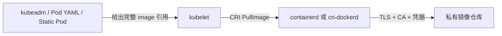

# 容器运行时与 Kubernetes 镜像仓库配置指南

> **适用范围**：Kubernetes v1.28、containerd 1.6/2.x、Docker Engine + cri-dockerd
> **核心目标**：彻底区分“运行时怎样访问仓库”和“Kubernetes 使用哪个镜像”，并说明手工安装与本项目脚本分别在哪里配置。
>
> ⚠️ 文中的用户名、密码、Token、AK、登录密钥均使用占位符。不要把真实凭据提交到 Git、README、镜像或可多人读取的脚本中。

---

## 1. 先建立正确的两层模型

镜像相关配置分为两个彼此独立的层次：

```text
第一层：Kubernetes 镜像引用层
回答：要拉取“哪个完整镜像名”？
例如：registry.example.com/k8s/kube-apiserver:v1.28.15

第二层：容器运行时仓库访问层
回答：怎样连接 registry.example.com？
包括：https/http、CA、镜像加速、用户名、密码、Token
```

一次拉取流程如下：



必须分别配置两层：

| 配置 | 解决什么问题 | 不能解决什么问题 |
|------|--------------|------------------|
| kubeadm `imageRepository`、YAML `image:` | Kubernetes 使用哪个镜像 | 不提供仓库密码，不自动信任自签 CA |
| containerd/Docker 仓库配置 | 如何连接、校验证书和认证 | 不会自动把 `docker.io/a` 改成 `registry.example.com/a` |
| `imagePullSecrets` | kubelet 拉取普通 Pod 私有镜像时提供凭据 | 不能被 static Pod 直接引用，也不改镜像名称 |

> **最重要结论**：只修改 `/etc/containerd/config.toml` 或 `/etc/docker/daemon.json`，不会自动改变 kubeadm、Calico、kube-vip 使用的镜像名；只改 `imageRepository`/`image:`，又不能自动解决私有仓库密码和自签证书问题。

---

## 2. 先确定 kubelet 实际使用哪个运行时

```bash
# 查看节点向 Kubernetes 报告的运行时
kubectl get nodes -o wide
kubectl get node "$(hostname)" -o jsonpath='{.status.nodeInfo.containerRuntimeVersion}{"\n"}'

# 查看 kubelet CRI endpoint
cat /var/lib/kubelet/kubeadm-flags.env
systemctl cat kubelet

# 使用 crictl 验证 CRI
crictl info
```

常见 endpoint：

```text
containerd：   unix:///run/containerd/containerd.sock
               或 unix:///var/run/containerd/containerd.sock

cri-dockerd：  unix:///var/run/cri-dockerd.sock
```

> Kubernetes v1.24 起移除了内置 dockershim。Kubernetes v1.28 若使用 Docker Engine，必须额外部署 `cri-dockerd`，不能只安装 Docker 就让 kubelet 直接使用它。

---

# 第一部分　containerd：仓库连接、TLS 和认证

## 3. containerd 的配置文件分别管什么

| 文件 | 作用 |
|------|------|
| `/etc/containerd/config.toml` | containerd 主配置、CRI 插件、sandbox/pause 镜像、`config_path` |
| `/etc/containerd/certs.d/<仓库主机>/hosts.toml` | 某仓库的 server、mirror、capabilities、CA、TLS 行为 |
| `/etc/containerd/certs.d/<仓库主机>/ca.crt` | 私有 CA 证书 |
| `/etc/crictl.yaml` | `crictl` 连接哪个 CRI socket；不是仓库配置 |

先确认版本和正在加载的配置：

```bash
containerd --version
systemctl cat containerd
containerd config dump > /tmp/containerd-effective.toml
journalctl -u containerd -b --no-pager | tail -100
```

containerd 1.6 和 2.x 的 CRI 插件配置结构不同，不能直接复制配置段：

```text
containerd 1.x 常见：plugins."io.containerd.grpc.v1.cri"
containerd 2.x 常见：plugins.'io.containerd.cri.v1.images'
```

必须以本机 `containerd config default`、`containerd config dump` 和日志为准。

## 4. 手工配置 containerd 使用仓库

以下假设：

```bash
REGISTRY_HOST="registry.example.com"
```

### 4.1 公有 HTTPS 仓库，无密码

在 containerd 主配置中启用 `certs.d`。实际段落随版本变化，关键结果是有效配置中出现：

```toml
config_path = "/etc/containerd/certs.d"
```

创建：

```bash
mkdir -p "/etc/containerd/certs.d/${REGISTRY_HOST}"
cat > "/etc/containerd/certs.d/${REGISTRY_HOST}/hosts.toml" <<EOF
server = "https://${REGISTRY_HOST}"

[host."https://${REGISTRY_HOST}"]
  capabilities = ["pull", "resolve"]
EOF
```

重启并测试：

```bash
systemctl restart containerd
crictl pull "${REGISTRY_HOST}/project/test:tag"
```

### 4.2 自签名或企业 CA 的 HTTPS 仓库

推荐信任 CA，而不是关闭证书校验：

```bash
mkdir -p "/etc/containerd/certs.d/${REGISTRY_HOST}"
cp company-root-ca.crt "/etc/containerd/certs.d/${REGISTRY_HOST}/ca.crt"

cat > "/etc/containerd/certs.d/${REGISTRY_HOST}/hosts.toml" <<EOF
server = "https://${REGISTRY_HOST}"

[host."https://${REGISTRY_HOST}"]
  capabilities = ["pull", "resolve"]
  ca = "/etc/containerd/certs.d/${REGISTRY_HOST}/ca.crt"
EOF

systemctl restart containerd
```

如果企业要求把 CA 加入系统信任库，还应按发行版更新系统 CA：

```bash
# Ubuntu/Debian
cp company-root-ca.crt /usr/local/share/ca-certificates/company-registry.crt
update-ca-certificates

# RHEL/CentOS
cp company-root-ca.crt /etc/pki/ca-trust/source/anchors/company-registry.crt
update-ca-trust
```

如果 HTTPS 仓库使用非 443 端口，`certs.d` 目录名同样必须包含端口，例如：

```text
/etc/containerd/certs.d/registry.example.com:8443/hosts.toml
```

仅限临时测试的跳过校验：

```toml
[host."https://registry.example.com"]
  capabilities = ["pull", "resolve"]
  skip_verify = true
```

> 生产环境不建议 `skip_verify = true`。它会削弱对中间人攻击和伪造仓库的防护。

### 4.3 HTTP 仓库

```toml
server = "http://registry.example.com:5000"

[host."http://registry.example.com:5000"]
  capabilities = ["pull", "resolve"]
```

目录名必须包含端口：

```text
/etc/containerd/certs.d/registry.example.com:5000/hosts.toml
```

> HTTP 会明文传输镜像和认证信息，只适合受控测试网络。生产环境应使用 HTTPS。

### 4.4 配置镜像加速/上游 mirror

如果目标是“访问 `docker.io/...` 时通过内部 mirror 下载”，而不是把 Kubernetes YAML 改成私有仓库名称，可以为源 registry 建 hosts namespace。例如：

```bash
mkdir -p /etc/containerd/certs.d/docker.io
cat > /etc/containerd/certs.d/docker.io/hosts.toml <<'EOF'
server = "https://registry-1.docker.io"

[host."https://mirror.example.com"]
  capabilities = ["pull", "resolve"]

[host."https://registry-1.docker.io"]
  capabilities = ["pull", "resolve"]
EOF
systemctl restart containerd
```

这里 Pod 仍写：

```yaml
image: docker.io/library/nginx:1.27
```

containerd 先尝试 mirror，再按配置回源。它不同于显式私有路径：

```yaml
image: registry.example.com/library/nginx:1.27
```

后者必须修改 Kubernetes 的镜像引用，而且私有仓库中必须存在该精确路径。若是完全 air-gap 环境，不应保留不可达的公网 fallback；应只配置内部 endpoint，并在断网条件下验证。

> mirror 不能凭空把 `docker.io/calico/node` 映射成任意不同的项目结构。mirror 必须按客户端请求的 repository/path 提供相应内容；需要改变路径时，应重新 tag/push 并修改 YAML。


## 5. containerd 私有仓库有密码时怎样配置


### 5.1 首选：由 Kubernetes 传递 `imagePullSecret`

普通 Deployment、DaemonSet、StatefulSet、Job、Pod 等，推荐由 Kubernetes Secret 提供认证，运行时只负责 TLS/CA/路由：

```bash
kubectl -n kube-system create secret docker-registry registry-credential \
  --docker-server=registry.example.com \
  --docker-username='<USERNAME>' \
  --docker-password='<PASSWORD_OR_TOKEN>'
```

Pod 模板引用：

```yaml
spec:
  imagePullSecrets:
    - name: registry-credential
  containers:
    - name: app
      image: registry.example.com/project/app:v1
```

也可以绑定到 ServiceAccount，使使用该 SA 的新 Pod 自动获得：

```bash
kubectl -n kube-system patch serviceaccount calico-node \
  -p '{"imagePullSecrets":[{"name":"registry-credential"}]}'
```

> Secret 必须和 Pod 位于同一 namespace。修改 ServiceAccount 不会修改已经创建的 Pod，需要滚动重建工作负载。

### 5.2 手工拉取或预拉镜像

`ctr` 不会自动读取 Docker 的 `~/.docker/config.json`，可显式传凭据：

```bash
ctr -n k8s.io images pull \
  --user '<USERNAME>:<PASSWORD_OR_TOKEN>' \
  registry.example.com/project/image:tag
```

使用 CRI 路径验证更接近 kubelet：

```bash
crictl pull \
  --creds '<USERNAME>:<PASSWORD_OR_TOKEN>' \
  registry.example.com/project/image:tag
```

避免密码进入 shell history：

```bash
read -r -p 'Registry username: ' REGISTRY_USERNAME
read -r -s -p 'Registry password/token: ' REGISTRY_PASSWORD
echo
crictl pull --creds "${REGISTRY_USERNAME}:${REGISTRY_PASSWORD}" \
  registry.example.com/project/image:tag
unset REGISTRY_PASSWORD
```

### 5.3 static Pod 为什么特殊

kube-apiserver、kube-controller-manager、kube-scheduler、etcd 以及本项目的 kube-vip 都是本地 static Pod。它们由 kubelet直接读取 `/etc/kubernetes/manifests/*.yaml`，不能像普通 Pod 一样直接依赖 Kubernetes API 中的 `imagePullSecret`。

可选方案：

1. **初始化前预拉镜像**：简单、适合固定版本和离线环境；凭据轮换不影响已存在镜像，但升级时必须再次预拉。
2. **配置 kubelet image credential provider**：适合生产中的动态凭据，但需要额外的 credential provider 插件、配置文件和 kubelet 参数；不能只写一个 registry 密码字段。
3. **containerd 1.6 旧式 CRI 全局认证**：特定版本可用，但已废弃，不应复制到 containerd 2.x。

### 5.4 containerd 1.6 旧式全局认证（仅兼容说明）

某些 containerd 1.6 配置支持：

```toml
[plugins."io.containerd.grpc.v1.cri".registry.configs."registry.example.com".auth]
  username = "<USERNAME>"
  password = "<PASSWORD_OR_TOKEN>"
```

然后：

```bash
chmod 600 /etc/containerd/config.toml
systemctl restart containerd
crictl pull registry.example.com/project/test:tag
```

但必须知道：

- 该方式属于旧 CRI registry 配置；
- 密码以明文写入主配置；
- containerd 2.x strict config 可能忽略或拒绝旧插件段；
- `hosts.toml` 的职责主要是 endpoint、mirror、capabilities 和 TLS，不应假定写入 `username/password` 就能认证；
- 新部署优先使用 `imagePullSecrets`、预拉取或 kubelet credential provider。

> **本项目实测边界**：CentOS 7 的 containerd 1.6.33 曾使用旧式 `registry.configs.*.auth` 拉取 SWR private；Ubuntu 24.04 实测安装到的 containerd 2.2.1 日志曾明确显示旧式配置在 strict mode 下被忽略。Ubuntu 22.04 或未来仓库版本可能不同，应以 `containerd --version` 为准；不能声称同一密码配置同时适用于 containerd 1.x/2.x。
>
> containerd 官方 `hosts.toml` schema 见 <https://github.com/containerd/containerd/blob/main/docs/hosts.md>，其字段用于 endpoint、capabilities、CA 和 TLS；不要自行添加文档未定义的 `username`/`password` 并假定会生效。

## 6. containerd 的 pause/sandbox 镜像

pause 镜像由运行时配置，不由业务 Pod YAML 指定。

containerd 1.x 常见：

```toml
[plugins."io.containerd.grpc.v1.cri"]
  sandbox_image = "registry.example.com/k8s/pause:3.9"
```

containerd 2.x 常见：

```toml
[plugins.'io.containerd.cri.v1.images'.pinned_images]
  sandbox = "registry.example.com/k8s/pause:3.9"
```

不同 2.x 打包版本生成的键位置可能不同，必须检查：

```bash
containerd config default | grep -n -E 'sandbox|pinned_images'
containerd config dump | grep -n -E 'sandbox|pinned_images'
crictl info
```

如果 pause 在私有仓库中，初始化前必须确认 CRI 能拉取：

```bash
crictl pull --creds '<USERNAME>:<PASSWORD_OR_TOKEN>' \
  registry.example.com/k8s/pause:3.9
```

---

# 第二部分　Docker Engine + cri-dockerd：仓库连接、TLS 和认证

## 7. Docker 配置文件分别管什么

| 文件 | 作用 |
|------|------|
| `/etc/docker/daemon.json` | Docker daemon 的 mirror、insecure registry、并发等配置 |
| `/etc/docker/certs.d/<仓库主机>/ca.crt` | 仓库私有 CA |
| `${DOCKER_CONFIG:-$HOME/.docker}/config.json` | `docker login` 的客户端凭据或 credential helper 配置 |
| cri-dockerd systemd unit/config | kubelet 到 Docker Engine 的 CRI 适配层 |

### 7.1 公网镜像加速

```json
{
  "registry-mirrors": [
    "https://mirror.example.com"
  ]
}
```

验证并重启：

```bash
dockerd --validate --config-file=/etc/docker/daemon.json
systemctl restart docker
docker info
```

> `registry-mirrors` 通常是 Docker Hub mirror 机制，不是任意源镜像到私有路径的通用重写规则。它也不会修改 Kubernetes YAML 中的 `image:`。

### 7.2 自签 CA

```bash
mkdir -p /etc/docker/certs.d/registry.example.com
cp company-root-ca.crt /etc/docker/certs.d/registry.example.com/ca.crt
systemctl restart docker
```

带端口的仓库目录必须包含端口：

```text
/etc/docker/certs.d/registry.example.com:5000/ca.crt
```

### 7.3 HTTP/insecure registry

```json
{
  "insecure-registries": [
    "registry.example.com:5000"
  ]
}
```

应用：

```bash
dockerd --validate --config-file=/etc/docker/daemon.json
systemctl restart docker
docker info
```

生产环境优先使用 HTTPS 和可信 CA，不要长期使用 insecure registry。

## 8. Docker 私有仓库密码怎样配置

交互登录：

```bash
docker login registry.example.com
```

非交互登录：

```bash
printf '%s' '<PASSWORD_OR_TOKEN>' | \
  docker login registry.example.com \
    --username '<USERNAME>' \
    --password-stdin
```

Docker CLI 默认把认证信息或 credential helper 引用写入：

```text
$HOME/.docker/config.json
```

查看登录用户对应的文件：

```bash
echo "${DOCKER_CONFIG:-$HOME/.docker}/config.json"
```

注意：

- root 执行 `docker login` 通常写 `/root/.docker/config.json`；普通用户登录写自己的 home；
- `docker login` 主要保证 Docker CLI 的 pull/push；不要未经验证就假定 kubelet/cri-dockerd 会自动使用某个用户 home 下的文件；
- 普通 Kubernetes Pod 仍推荐使用 `imagePullSecrets`；
- static Pod 推荐初始化前预拉，或配置 kubelet credential provider；
- 优先使用 registry Token 或机器人账号，不要使用个人长期密码；
- 推荐使用 Docker credential store，避免在 `config.json` 中保存可逆的 base64 凭据。

预拉 static Pod 镜像：

```bash
docker login registry.example.com
docker pull registry.example.com/k8s/kube-apiserver:v1.28.15
docker pull registry.example.com/k8s/etcd:3.5.15-0
```

### 8.1 Docker/cri-dockerd 环境下的 static Pod

Docker 登录解决的是 Docker CLI 访问仓库；static Pod 仍不能直接引用 Kubernetes API 中的 `imagePullSecret`。在 kubeadm 初始化前应二选一：

1. 用部署所使用的节点账号执行 `docker login` 并预拉全部控制面、etcd、pause 和 kube-vip 镜像；
2. 配置 kubelet image credential provider，并用 `crictl pull` 验证 CRI 路径。

```bash
docker login registry.example.com
docker pull registry.example.com/k8s/kube-apiserver:v1.28.15
docker pull registry.example.com/k8s/etcd:3.5.15-0
crictl --runtime-endpoint unix:///var/run/cri-dockerd.sock images
```

不要只验证 `docker pull`：最终应通过 cri-dockerd endpoint 和一次实际 static Pod 启动确认 kubelet 可用。


## 9. kubelet 使用 Docker 时还必须配置 cri-dockerd

cri-dockerd 的 Pod sandbox 镜像由其启动参数指定，常见参数是：

```text
--pod-infra-container-image=registry.example.com/k8s/pause:3.9
```

具体应通过 `cri-dockerd --help` 和 `systemctl cat cri-docker.service` 核对已安装版本；修改 systemd override 后执行 `systemctl daemon-reload && systemctl restart cri-docker`。该设置与 Docker 的 `registry-mirrors`、Kubernetes Pod 的 `image:` 是不同层次。


```yaml
apiVersion: kubeadm.k8s.io/v1beta3
kind: InitConfiguration
nodeRegistration:
  criSocket: unix:///var/run/cri-dockerd.sock
```

或命令行：

```bash
kubeadm init \
  --cri-socket unix:///var/run/cri-dockerd.sock \
  ...
```

`crictl`：

```yaml
# /etc/crictl.yaml
runtime-endpoint: unix:///var/run/cri-dockerd.sock
image-endpoint: unix:///var/run/cri-dockerd.sock
timeout: 10
```

验证：

```bash
systemctl status docker cri-docker.socket cri-docker.service
crictl info
```

---

# 第三部分　手工安装 Kubernetes 时在哪里指定镜像

## 10. kubeadm 核心镜像

### 10.1 推荐：kubeadm YAML

```yaml
# /root/kubeadm-config.yaml
apiVersion: kubeadm.k8s.io/v1beta3
kind: InitConfiguration
nodeRegistration:
  criSocket: unix:///run/containerd/containerd.sock
---
apiVersion: kubeadm.k8s.io/v1beta3
kind: ClusterConfiguration
kubernetesVersion: v1.28.15
imageRepository: registry.example.com/google_containers
networking:
  podSubnet: 10.244.0.0/16
  serviceSubnet: 10.96.0.0/12
  dnsDomain: cluster.local
```

先看 kubeadm 最终会用哪些完整镜像名：

```bash
kubeadm config images list --config /root/kubeadm-config.yaml
```

预拉：

```bash
kubeadm config images pull --config /root/kubeadm-config.yaml
```

初始化：

```bash
kubeadm init --config /root/kubeadm-config.yaml --upload-certs
```

> `imageRepository` 只负责拼出镜像名，不包含用户名密码。私有认证必须由运行时、预拉取、kubelet credential provider 或其他凭据机制解决。

### 10.2 直接在 `kubeadm init` 命令行指定（完整示例）

可以不创建 `kubeadm-config.yaml`，直接在初始化命令中使用 `--image-repository`。下面是 containerd、单 Master也适用的完整示例；`k8s-api` 必须已经通过 DNS 或 `/etc/hosts` 解析到当前控制面 IP（多 Master时解析到 VIP/LB）：

```bash
kubeadm init \
  --kubernetes-version=v1.28.15 \
  --image-repository=registry.example.com/google_containers \
  --pod-network-cidr=10.244.0.0/16 \
  --service-cidr=10.96.0.0/12 \
  --control-plane-endpoint=k8s-api:6443 \
  --apiserver-advertise-address=192.168.104.104 \
  --apiserver-cert-extra-sans=k8s-api,192.168.104.104 \
  --cri-socket=unix:///run/containerd/containerd.sock \
  --upload-certs
```

各参数的作用：

| 参数 | 作用 | 示例/注意事项 |
|------|------|---------------|
| `--kubernetes-version` | 固定 Kubernetes 版本并决定核心组件 tag | `v1.28.15` |
| `--image-repository` | 设置 kubeadm 核心镜像前缀 | 不包含密码；必须与仓库实际路径一致 |
| `--pod-network-cidr` | Pod 地址池 | 必须和所选 CNI 配置一致；本项目 Calico 为 `10.244.0.0/16` |
| `--service-cidr` | Service ClusterIP 地址池 | 建群后不宜修改；本项目为 `10.96.0.0/12` |
| `--control-plane-endpoint` | 所有节点和客户端使用的稳定控制面入口 | 单 Master可先映射到 master1；多 Master指向 VIP/LB |
| `--apiserver-advertise-address` | 当前这台 master 的 API Server 通告地址 | 填本机实际管理 IP，不填 VIP |
| `--apiserver-cert-extra-sans` | 加入 API Server 证书 SAN | 应包含 `k8s-api`、VIP及需要直接访问的地址 |
| `--cri-socket` | kubelet/kubeadm 使用的 CRI endpoint | containerd 或 cri-dockerd 二选一 |
| `--upload-certs` | 上传控制面共享证书，便于其他 master join | 主要用于多 Master；certificate-key 有时效 |

初始化前推荐先用完全相同的版本、仓库和 CRI 参数打印、预拉镜像：

```bash
kubeadm config images list \
  --kubernetes-version=v1.28.15 \
  --image-repository=registry.example.com/google_containers

kubeadm config images pull \
  --kubernetes-version=v1.28.15 \
  --image-repository=registry.example.com/google_containers \
  --cri-socket=unix:///run/containerd/containerd.sock
```

如果使用 Docker Engine + cri-dockerd，只替换 CRI endpoint：

```bash
kubeadm init \
  --kubernetes-version=v1.28.15 \
  --image-repository=registry.example.com/google_containers \
  --pod-network-cidr=10.244.0.0/16 \
  --service-cidr=10.96.0.0/12 \
  --control-plane-endpoint=k8s-api:6443 \
  --apiserver-advertise-address=192.168.104.104 \
  --apiserver-cert-extra-sans=k8s-api,192.168.104.104 \
  --cri-socket=unix:///var/run/cri-dockerd.sock \
  --upload-certs
```

> `--image-repository` 只影响 kubeadm 管理的核心镜像，不修改 Calico、kube-vip、Ingress、MetalLB 或业务 Pod 的 `image:`。它也不携带仓库用户名、密码或 CA。
>
> 命令行适合实验和一次性安装；生产、多 Master和自动化场景更推荐 10.1 的 YAML，因为证书 SAN、etcd、kubelet、kube-proxy 等配置更容易完整保存、审计和复现。使用 `--config` 时不要再混合重复的命令行配置参数。


### 10.3 CoreDNS 路径不能靠猜

不同 kubeadm 版本可能把 CoreDNS 拼成带子路径的名称。推送私有仓库之前，始终以该命令输出为准：

```bash
kubeadm config images list --config /root/kubeadm-config.yaml
```

私有仓库必须存在输出中的**完全相同路径和 tag**。例如 kubeadm v1.28 的输出可能是：

```text
registry.example.com/google_containers/coredns:v1.10.1
```

也可能因使用的仓库布局或 kubeadm 版本表现为带额外子路径的形式。不要按记忆创建仓库；直接复制 `kubeadm config images list --config ...` 的逐行输出作为推送目标并验收。


## 11. Calico 镜像

Calico 不读取 kubeadm 的 `imageRepository`。它使用自身 YAML 中的每个 `image:`：

```bash
grep -n 'image:' calico.yaml
```

修改为：

```yaml
image: registry.example.com/docker.io/calico/cni:v3.26.4
image: registry.example.com/docker.io/calico/node:v3.26.4
image: registry.example.com/docker.io/calico/kube-controllers:v3.26.4
```

私有仓库 Secret：

```bash
kubectl -n kube-system create secret docker-registry registry-credential \
  --docker-server=registry.example.com \
  --docker-username='<USERNAME>' \
  --docker-password='<PASSWORD_OR_TOKEN>'
```

在 Calico Pod template 的 `spec` 中加入：

```yaml
imagePullSecrets:
  - name: registry-credential
```

Calico manifest 至少包含 `calico-node` DaemonSet 与 `calico-kube-controllers` Deployment 两个独立 Pod template，且 `calico-node` 还有 init containers。镜像名称都要改，`imagePullSecrets` 也必须分别加入每个需要私有拉取的 Pod template；只改其中一个工作负载并不完整。

或者把 Secret 绑定到各 manifest 实际使用的 ServiceAccount。应用前检查最终 YAML：

```bash
grep -n -E 'serviceAccountName:|image:|imagePullSecrets:' calico.yaml
kubectl apply -f calico.yaml
```

## 12. kube-vip 镜像

本项目仅在多 Master（`MASTER_COUNT > 1`）时把 kube-vip 部署成 static Pod；单 Master 不生成该 manifest，而是让 `k8s-api` 指向 master1。多 Master 的镜像位置是：

```text
/etc/kubernetes/manifests/kube-vip.yaml
```

手工配置：

```yaml
spec:
  containers:
    - name: kube-vip
      image: registry.example.com/ghcr.io/kube-vip/kube-vip:v0.8.0
      imagePullPolicy: IfNotPresent
```

由于是 static Pod，应在生成 manifest 前保证镜像可用：

```bash
crictl pull --creds '<USERNAME>:<PASSWORD_OR_TOKEN>' \
  registry.example.com/ghcr.io/kube-vip/kube-vip:v0.8.0
```

## 13. 普通业务镜像

Deployment 等直接在 Pod template 中指定：

```yaml
apiVersion: apps/v1
kind: Deployment
metadata:
  name: demo
spec:
  template:
    spec:
      imagePullSecrets:
        - name: registry-credential
      containers:
        - name: demo
          image: registry.example.com/business/demo:v1.0.0
          imagePullPolicy: IfNotPresent
```

`imagePullPolicy` 不提供凭据：

- `Always`：每次启动都解析远端镜像；仓库不可达或无凭据时失败；
- `IfNotPresent`：本地有相同镜像引用时使用本地，否则拉取；
- `Never`：只允许本地镜像，缺失即失败。

## 14. 已有集群修改镜像位置

仅修改初始 kubeadm 文件不会自动更新已运行集群。

查看 kubeadm 保存配置：

```bash
kubectl -n kube-system get configmap kubeadm-config -o yaml
```

控制面 static Pod 实际文件：

```text
/etc/kubernetes/manifests/kube-apiserver.yaml
/etc/kubernetes/manifests/kube-controller-manager.yaml
/etc/kubernetes/manifests/kube-scheduler.yaml
/etc/kubernetes/manifests/etcd.yaml
/etc/kubernetes/manifests/kube-vip.yaml
```

DaemonSet/Deployment：

```bash
kubectl -n kube-system get daemonset kube-proxy -o yaml
kubectl -n kube-system get daemonset calico-node -o yaml
kubectl -n kube-system get deployment calico-kube-controllers -o yaml
kubectl -n kube-system get deployment coredns -o yaml
```

> 修改控制面 static Pod 会触发组件重建。多 Master 应逐台操作并持续检查 API Server 和 etcd 健康；不要一次修改所有 Master。

---

# 第四部分　本项目脚本怎样实现同样效果

## 15. 本项目只需理解四组镜像变量

每套方案都有自己的：

```text
<方案>/config/cluster.env
```

关键变量：

```bash
# kubeadm 核心镜像前缀
IMAGE_REPOSITORY="registry.example.com/google_containers"

# containerd 的 Pod sandbox/pause 镜像
PAUSE_IMAGE="${IMAGE_REPOSITORY}/pause:3.9"

# Calico 镜像前缀；脚本会再拼 /calico/<组件>:<版本>
CALICO_IMAGE_REGISTRY="registry.example.com/docker.io"

# kube-vip 完整镜像引用
KUBEVIP_IMAGE="registry.example.com/ghcr.io/kube-vip/kube-vip:v0.8.0"
```

如果使用 SWR，还包括：

```bash
SWR_REGION="cn-southwest-2"
SWR_ORG="<SWR_ORG>"
PRIVATE_REGISTRY="swr.${SWR_REGION}.myhuaweicloud.com/${SWR_ORG}"
SWR_PRIVATE="true"
SWR_AK="<ACCESS_KEY_ID>"
SWR_LOGIN_KEY="<SWR_LOGIN_TOKEN>"
SWR_USERNAME="${SWR_REGION}@${SWR_AK#*@}"
```

> 真实凭据不应长期保存在 `cluster.env`。更安全的做法是在执行前通过受控权限文件或环境变量注入，并在部署后轮换/清理。至少应执行 `chmod 600 config/cluster.env`，且不得提交到 Git。

## 16. 变量分别在哪里落地

| 变量 | 脚本 | 最终位置/效果 |
|------|------|---------------|
| `PAUSE_IMAGE` | `scripts/02-install-containerd.sh` | `/etc/containerd/config.toml` 的 `sandbox_image`（1.x）或脚本识别到的 `sandbox`（2.x） |
| `IMAGE_REPOSITORY` | `scripts/04-init-master1.sh` | `/etc/kubernetes/kubeadm-config.yaml` 的 `imageRepository` |
| `KUBEVIP_IMAGE` | `scripts/04-init-master1.sh` | `/etc/kubernetes/manifests/kube-vip.yaml` 的 `image:` |
| `CALICO_IMAGE_REGISTRY` | `scripts/07-install-calico.sh` | 替换临时 `/tmp/calico.yaml` 中 Calico `image:` |
| `PRIVATE_REGISTRY` | SWR `02-install-containerd.sh` | registry host、`certs.d/<host>/hosts.toml` |
| SWR 凭据 | SWR `02-install-containerd.sh` | 旧式 containerd 1.6 auth；containerd 2.x 不保证有效 |

### 16.1 Phase 2：运行时仓库层

```text
scripts/02-install-containerd.sh
```

实现：

1. 安装 containerd；
2. 生成 `/etc/containerd/config.toml`；
3. 设置 systemd cgroup；
4. 将 `PAUSE_IMAGE` 写入 sandbox 配置；
5. SWR 方案创建 `/etc/containerd/certs.d/<host>/hosts.toml`；
6. 重启 containerd；
7. 写 `/etc/crictl.yaml`。

版本边界：

- Red Hat/CentOS 当前是 containerd 1.6.33，旧式 CRI auth 曾实测可用；
- Ubuntu 脚本通过 `apt-get install containerd` 安装发行版当前候选版本，并**没有使用** `cluster.env` 中旧的 `CONTAINERD_VERSION` 值锁定版本；Ubuntu 24.04 实测为 2.2.1，Ubuntu 22.04 或仓库未来版本可能不同；
- Ubuntu SWR 的 `02-install-containerd.sh` 当前仍写入旧式 `io.containerd.grpc.v1.cri.registry.configs` 兼容段，但 2.x strict mode 可能忽略它；
- 因此 Ubuntu private SWR 不能只凭脚本返回成功或配置文件中出现账号密码就判定认证成功，必须执行 `containerd --version` 和 `crictl pull` 实测；可靠兜底是显式凭据预拉 static Pod 镜像，普通 Pod 使用 `imagePullSecret`。

### 16.2 Phase 4：Kubernetes 核心镜像与 kube-vip

```text
scripts/04-init-master1.sh
```

脚本生成：

```yaml
# /etc/kubernetes/kubeadm-config.yaml
kind: ClusterConfiguration
imageRepository: "${IMAGE_REPOSITORY}"
```

然后执行：

```bash
kubeadm config images pull --config /etc/kubernetes/kubeadm-config.yaml
kubeadm init --config /etc/kubernetes/kubeadm-config.yaml --upload-certs
```

多 Master 时，它还生成：

```yaml
# /etc/kubernetes/manifests/kube-vip.yaml
image: ${KUBEVIP_IMAGE}
```

kube-vip 不属于 `kubeadm config images list` 的核心清单，脚本会在生成 manifest 前单独执行：

```bash
ctr -n k8s.io images pull "${KUBEVIP_IMAGE}"
```

当前这条 `ctr` 命令没有显式传递 private 仓库凭据；如果镜像尚未预拉且仓库要求认证，它可能返回 401。部署前应先用 `crictl pull --creds ...` 或受支持的 credential provider 准备该镜像，再执行 Phase 4。


### 16.3 Phase 7：Calico 镜像

```text
scripts/07-install-calico.sh
```

脚本把 manifest 中：

```text
docker.io/calico/*
m.daocloud.io/docker.io/calico/*
calico/*
```

统一替换成：

```text
${CALICO_IMAGE_REGISTRY}/calico/*
```

最终应用的是：

```text
/tmp/calico.yaml
```

检查：

```bash
grep -n 'image:' /tmp/calico.yaml
kubectl -n kube-system get ds calico-node \
  -o jsonpath='{.spec.template.spec.containers[*].image}{"\n"}'
kubectl -n kube-system get deploy calico-kube-controllers \
  -o jsonpath='{.spec.template.spec.containers[*].image}{"\n"}'
```

## 17. 本项目切换为一个新的私有仓库

假设目标前缀：

```text
registry.example.com/company
```

在所选方案的 `config/cluster.env` 修改：

```bash
PRIVATE_REGISTRY="registry.example.com/company"
IMAGE_REPOSITORY="${PRIVATE_REGISTRY}/google_containers"
PAUSE_IMAGE="${IMAGE_REPOSITORY}/pause:3.9"
CALICO_IMAGE_REGISTRY="${PRIVATE_REGISTRY}/docker.io"
KUBEVIP_IMAGE="${PRIVATE_REGISTRY}/ghcr.io/kube-vip/kube-vip:${KUBEVIP_VERSION}"
```

仓库中必须实际存在：

```text
registry.example.com/company/google_containers/kube-apiserver:v1.28.15
registry.example.com/company/google_containers/kube-controller-manager:v1.28.15
registry.example.com/company/google_containers/kube-scheduler:v1.28.15
registry.example.com/company/google_containers/kube-proxy:v1.28.15
registry.example.com/company/google_containers/etcd:3.5.15-0
registry.example.com/company/google_containers/coredns:v1.10.1
registry.example.com/company/google_containers/pause:3.9
registry.example.com/company/docker.io/calico/node:v3.26.4
registry.example.com/company/docker.io/calico/cni:v3.26.4
registry.example.com/company/docker.io/calico/kube-controllers:v3.26.4
registry.example.com/company/ghcr.io/kube-vip/kube-vip:v0.8.0
```

部署前打印最终清单：

```bash
source config/cluster.env
kubeadm config images list \
  --kubernetes-version "v${KUBE_VERSION}" \
  --image-repository "${IMAGE_REPOSITORY}"
printf '%s\n' \
  "${CALICO_IMAGE_REGISTRY}/calico/node:${CALICO_VERSION}" \
  "${CALICO_IMAGE_REGISTRY}/calico/cni:${CALICO_VERSION}" \
  "${CALICO_IMAGE_REGISTRY}/calico/kube-controllers:${CALICO_VERSION}" \
  "${KUBEVIP_IMAGE}"
```

> Ubuntu 和 Red Hat/CentOS 在版本与架构相同时共用上述同一批镜像，仓库只需推送一次；两套目录都要使用同样的变量值，但 deb/rpm 仍分别准备。

## 18. 本项目 private 仓库的推荐部署流程

### containerd 1.6（当前 CentOS 7）

```text
1. 修改 redhat/swr/config/cluster.env 的镜像变量
2. 配置 TLS/CA
3. 如继续使用旧式全局 auth，运行 02 后必须 crictl pull 实测
4. 执行 04 前确认 7 个核心镜像和 kube-vip 能拉取
5. 执行 07 前为 Calico配置 Secret，或在所有节点预拉 Calico
```

### containerd 2.2（当前 Ubuntu 24.04）

```text
1. 修改 ubuntu/swr/config/cluster.env 的镜像变量
2. 02 只负责 certs.d、TLS/CA、sandbox 和运行时基础配置
3. 不依赖旧 io.containerd.grpc.v1.cri.registry.configs auth
4. 初始化前用 crictl --creds 预拉核心、pause、kube-vip
5. Calico 使用 imagePullSecret，或在所有节点预拉
6. 每一步都用 crictl images / kubectl describe pod 验证
```

当前项目的 Ubuntu SWR 实机验收曾通过“每节点预拉 private Calico node 镜像 + `IfNotPresent`”完成。因此在没有实现并验证 kubelet credential provider 前，文档和脚本不得宣称 containerd 2.2 的通用全局密码配置已经解决。

---

# 第五部分　验证、排障与安全

## 19. 四层验证顺序

### 19.1 DNS/TCP/TLS

```bash
getent hosts registry.example.com
curl -vk https://registry.example.com/v2/
```

返回 `401 Unauthorized` 往往说明网络和 TLS 已通，只是缺少认证；证书错误则先修 CA。

### 19.2 运行时手工拉取

containerd：

```bash
crictl pull --creds '<USERNAME>:<PASSWORD_OR_TOKEN>' \
  registry.example.com/project/test:tag
crictl images
```

Docker：

```bash
docker login registry.example.com
docker pull registry.example.com/project/test:tag
docker image ls
```

### 19.3 kubeadm 镜像名

```bash
kubeadm config images list --config /etc/kubernetes/kubeadm-config.yaml
```

将输出和仓库实际路径逐字符比较，特别检查 CoreDNS 子路径。

### 19.4 Kubernetes Pod

```bash
kubectl -n kube-system get pods -o wide
kubectl -n kube-system describe pod <POD_NAME>
kubectl -n kube-system get events --sort-by=.lastTimestamp
journalctl -u kubelet -b --no-pager | tail -200
journalctl -u containerd -b --no-pager | tail -200
```

## 20. 常见错误

| 现象 | 根因 | 修复方向 |
|------|------|----------|
| `x509: certificate signed by unknown authority` | 运行时不信任仓库 CA | 配 `certs.d`/Docker CA，更新系统 CA |
| `http: server gave HTTP response to HTTPS client` | 仓库是 HTTP，运行时按 HTTPS 连接 | 正确配置 HTTP endpoint；生产改 HTTPS |
| `401`/`unauthorized` | 缺凭据、凭据过期或权限不足 | 重新登录/Token、检查 Secret 和仓库 ACL |
| `not found`/`manifest unknown` | imageRepository、子路径或 tag 不存在 | 对比 kubeadm/YAML 的完整镜像名 |
| `ImagePullBackOff` 但手工 `docker pull` 成功 | kubelet 使用的不是该凭据或不是 Docker runtime | 查 CRI endpoint，用 crictl 和 Pod Secret 验证 |
| containerd 2.x 写了密码仍 401 | 使用了被 strict mode 忽略的旧 CRI 配置 | 使用 Secret、预拉或 credential provider |
| static Pod 无法引用 Secret | static Pod 不由 API 中普通 Pod controller 管理 | 预拉镜像或 credential provider |
| 本地有镜像仍拉取 | 镜像完整引用不同或 pull policy 为 Always | 补相同 tag，检查 `imagePullPolicy` |
| `ctr images ls` 有、kubelet 看不到 | 导入到了非 `k8s.io` namespace | 使用 `ctr -n k8s.io` |

## 21. 凭据安全基线

- 使用机器人账号、短期 Token 或最小权限账号；
- 拉取节点只授予 pull，不授予 push/delete；
- 不在 Git、README、终端录屏、工单中暴露密码；
- 避免命令行明文参数进入 shell history 和进程列表；
- Secret 不是加密保险箱，etcd 应启用静态加密并限制 RBAC；
- `config.toml`、Docker config、credential provider 文件权限至少为 `0600`；
- 部署完成后删除临时凭据文件，轮换曾经明文暴露的密钥；
- 修改认证方式后，分别用 `crictl pull` 和真实 Pod 做端到端验证。

---

## 22. 一页速查

| 需求 | containerd | Docker + cri-dockerd | Kubernetes 镜像引用 |
|------|------------|----------------------|-----------------------|
| 主配置 | `/etc/containerd/config.toml` | `/etc/docker/daemon.json` | kubeadm config / Pod YAML |
| 仓库 endpoint/CA | `/etc/containerd/certs.d/<host>/hosts.toml` | `/etc/docker/certs.d/<host>/ca.crt` | 不在这里配置 |
| CLI 登录 | `ctr --user`、`crictl --creds`、nerdctl login | `docker login` | 不在这里配置 |
| 普通 Pod 密码 | `imagePullSecrets` 经 CRI 传入 | `imagePullSecrets` 经 CRI 传入 | Pod/ServiceAccount 引用 Secret |
| static Pod 密码 | 预拉或 kubelet credential provider | 预拉或 kubelet credential provider | static Pod 不能直接引用 API Secret |
| pause 镜像 | containerd `sandbox_image`/`sandbox` | `cri-dockerd --pod-infra-container-image` 启动参数 | 不是业务 Pod YAML |
| K8s 核心镜像 | 只负责拉取 | 只负责拉取 | kubeadm `imageRepository` |
| Calico | 只负责拉取 | 只负责拉取 | `calico.yaml` 的 `image:` |
| kube-vip | 只负责拉取 | 只负责拉取 | static Pod 的 `image:` |

最终记住：

```text
运行时配置 = 怎么访问仓库
Kubernetes 配置 = 使用哪个完整镜像
私有仓库凭据 = 普通 Pod 用 imagePullSecret；static Pod 用预拉或 credential provider
```

---

## 参考资料

- containerd Registry Configuration：<https://github.com/containerd/containerd/blob/main/docs/hosts.md>
- containerd CRI Registry：<https://github.com/containerd/containerd/blob/main/docs/cri/registry.md>
- Docker daemon 配置：<https://docs.docker.com/reference/cli/dockerd/>
- Docker login：<https://docs.docker.com/reference/cli/docker/login/>
- Kubernetes Images：<https://kubernetes.io/docs/concepts/containers/images/>
- Kubernetes Pull Image Private Registry：<https://kubernetes.io/docs/tasks/configure-pod-container/pull-image-private-registry/>
- kubeadm config：<https://kubernetes.io/docs/reference/setup-tools/kubeadm/kubeadm-config/>
- kubelet Credential Provider：<https://kubernetes.io/docs/tasks/administer-cluster/kubelet-credential-provider/>
- cri-dockerd：<https://github.com/Mirantis/cri-dockerd>
